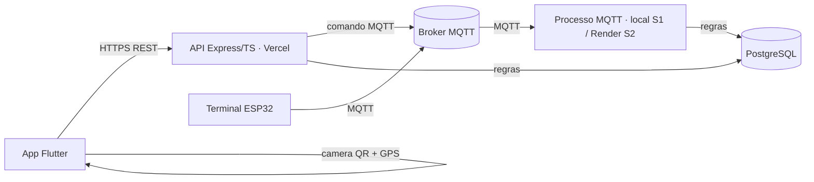

# ABP4 · Sistema de Controle de Acesso

[](https://github.com/ErrorSquad-ABP/ABP4-Sistema-Controle-Acesso/actions/workflows/ci-backend.yml)
[](https://github.com/ErrorSquad-ABP/ABP4-Sistema-Controle-Acesso/actions/workflows/ci-mobile.yml)
[](https://github.com/ErrorSquad-ABP/ABP4-Sistema-Controle-Acesso/actions/workflows/ci-firmware.yml)

Sistema integrado de baixo custo para o controle de acesso em edifícios: um Terminal de Acesso exibe um QR Code rotativo (gerado no backend e renovado a cada 10 segundos) e também lê tags NFC; o app móvel autentica o usuário, escaneia o QR e informa a geolocalização; o backend em nuvem concentra as regras de acesso — credenciais, autorizações, janelas de uso, limite de 100 m e registro de eventos — e conversa com o terminal por MQTT. Este monorepo reúne backend, mobile, firmware, infraestrutura e documentação do projeto.

## Arquitetura



Na S1 o processo MQTT roda localmente (US-04); na S2 ele foi para o Render (US-37, PR #26) — o código e o `render.yaml` estão na `main`, mas o deploy efetivo no Render **não foi observado**. A Vercel hospeda só a API, e essa está no ar: em 29/10/2026 o `/health` público respondeu `version: 7eab133`, `database: ok`. O relay da outbox roda apenas entre **18:45 e 23:05** em `America/Sao_Paulo` (DT-21, PR #45), para não manter o Neon acordado 24/7. Detalhes dos fluxos de acesso (QR e NFC), dos ambientes e da matriz de transporte em [`docs/architecture/visao-geral.md`](docs/architecture/visao-geral.md); tópicos, payloads, QoS e expiração do MQTT em [`docs/architecture/contratos-mqtt.md`](docs/architecture/contratos-mqtt.md).

## Estrutura do monorepo

Itens marcados com `*` são previstos (ainda não existem) e entram pelos cards indicados.

```text
ABP4-Sistema-Controle-Acesso/
├─ backend/                  Node + Express + TypeScript
│  ├─ src/                   domain · application · infrastructure · main · shared
│  ├─ prisma/                schema.prisma · migrations · seed.ts
│  └─ tests/                 unit/ · integration/
├─ mobile/                   Flutter
│  ├─ lib/                   core/ · features/ (auth, authorizations, scanner, admin — previstas)
│  └─ test/ · pubspec.yaml
├─ firmware/                 ESP32 · PlatformIO (C++); periféricos físicos na US-08
│  ├─ src/                   main.cpp + modules/ (mqtt, display, nfc, gps, feedback, door)
│  ├─ include/               config.example.h (WiFi/broker/tópicos — sem segredos)
│  ├─ wokwi/                 diagram.json + wokwi.toml
│  └─ platformio.ini
├─ docs/
│  ├─ scrum/                 processo, product-backlog, DoD, sprints e templates
│  ├─ architecture/          visao-geral.md · contratos-mqtt.md · modelo-dados.md · adr/
│  ├─ api/                   openapi.yaml (gerado) · README.md — contrato REST v1
│  └─ guides/                desenvolvimento.md · como-rodar.md · deploy.md
├─ infra/                    docker-compose.dev.yml (Mosquitto + Postgres) · mosquitto/
├─ design/                   export de assets do Figma
├─ .github/
│  ├─ workflows/             ci-backend.yml · ci-mobile.yml · ci-firmware.yml ·
│  │                         cd-backend.yml · trello-link.yml
│  └─ CODEOWNERS · PULL_REQUEST_TEMPLATE.md · ISSUE_TEMPLATE/
└─ README.md · .gitignore · .editorconfig
```

**Regra de dependência (backend)**: `domain` não importa nada externo; `application` importa só `domain`; `infrastructure` implementa os contratos; `main` monta tudo. Casos de uso não conhecem Express, Prisma ou MQTT — falam via interfaces.

## Stacks

| Área | Stack | Observações |
|---|---|---|
| Backend | Node LTS + Express + TypeScript, Prisma + PostgreSQL, Zod, mqtt.js, JWT, Vitest | Versões pinadas na implementação conforme docs atuais |
| Mobile | Flutter, Riverpod, go_router, `mobile_scanner` (QR), `geolocator` | Android é o alvo principal da entrega |
| Firmware | ESP32, PlatformIO (C++/Arduino), módulos por responsabilidade, Wokwi p/ simulação | Reaproveita lógica do sketch legado (servo/LED/buzzer) |
| Infra dev | docker-compose: Eclipse Mosquitto + PostgreSQL | Espelha o legado; atende RP12 |
| Infra prod | **Vercel** (API serverless) · **Render** (worker MQTT) · **Neon** (Postgres) · HiveMQ Cloud (MQTT TLS) | Free tiers; atende RNF06, RP11, RNF02 · ver `docs/architecture/adr/001` |

## Como rodar localmente

Passo a passo de ambiente, infraestrutura e execução em [`docs/guides/como-rodar.md`](docs/guides/como-rodar.md).

## Documentação

- [`docs/scrum/README.md`](docs/scrum/README.md) — como o time aplica Scrum (backlog, DoD, sprints e templates).
- [`docs/entrega/review-1.md`](docs/entrega/review-1.md) — documento de entrega da Review 1 (Sprint 1).
- [`docs/entrega/README.md`](docs/entrega/README.md) — índice das evidências por card (`docs/entrega/evidencias/`).
- [`docs/architecture/visao-geral.md`](docs/architecture/visao-geral.md) — arquitetura, fluxos de acesso e matriz de transporte.
- [`docs/architecture/contratos-mqtt.md`](docs/architecture/contratos-mqtt.md) — contrato MQTT v1 (tópicos, payloads, QoS, ids e expiração).
- [`docs/architecture/modelo-dados.md`](docs/architecture/modelo-dados.md) — diagrama ER do modelo Prisma v1.
- [`docs/guides/desenvolvimento.md`](docs/guides/desenvolvimento.md) — branches, commits, PRs, review e CI.
- [`docs/architecture/caso-de-uso-modelo.md`](docs/architecture/caso-de-uso-modelo.md) — como estender o backend (camadas, erros, env, testes).

## Equipe

**ErrorSquad** · ABP 2026-2 · 4DSM · FATEC Jacareí — SM: João Victor Lopes Rosa ([@JV-L0pes](https://github.com/JV-L0pes)) · PO: Felipe Pacheco ([@FelipePacheco30](https://github.com/FelipePacheco30)) · Devs: [@Carlos-Santo](https://github.com/Carlos-Santo), [@Caiuuutecnologico](https://github.com/Caiuuutecnologico), [@Leo-Slv](https://github.com/Leo-Slv), [@ArtFacchinetti](https://github.com/ArtFacchinetti).
