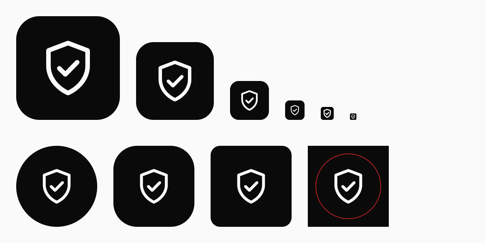

# Identidade de distribuição — "Controle de Acesso" (US-38)

Uma marca só para o navegador, a web instalada e o launcher do Android: o **escudo com check** da tela Entrar do Figma, em traço branco sobre o preto do design system (`#0A0A0A`). Nenhum ícone do Flutter é usado.



Linha de cima: ícone de uso geral em 256, 192, 96 e 48 px e favicon em 32 e 16 px. Linha de baixo: a versão *maskable* recortada pelas máscaras de launcher mais comuns (círculo, squircle e quadrado arredondado) e a zona segura de 80% em vermelho.

## Arquivos

| Arquivo | Papel |
|---|---|
| [`marca.svg`](marca.svg) | **fonte única**: os paths `escudo` e `check` em caixa de 24 unidades, traço de 1,5 do design system |
| [`gerar_icones.py`](gerar_icones.py) | gera as variantes e todos os ícones do app a partir da marca |
| `icone.svg` | uso geral: ladrilho arredondado, marca em 62,5% |
| `icone-maskable.svg` | sangrado, marca em 51% (dentro do círculo seguro de 80%) |
| `favicon.svg` | aba do navegador: marca maior e traço mais grosso para ler em 16–32 px |
| `previa.png` | folha de conferência acima |

Os três SVGs de variante e a prévia são gerados; edite só a `marca.svg`.

## O que o script gera

| Destino | Origem |
|---|---|
| `mobile/web/favicon.png` (32 px) | `favicon.svg` |
| `mobile/web/icons/Icon-192.png`, `Icon-512.png` | `icone.svg` |
| `mobile/web/icons/Icon-maskable-192.png`, `Icon-maskable-512.png` | `icone-maskable.svg` |
| `mobile/android/app/src/main/res/mipmap-*/ic_launcher.png` (48–192 px) | `icone.svg`, para Android 7 e anteriores |
| `res/mipmap-anydpi-v26/ic_launcher.xml` | ícone adaptativo (Android 8+): fundo, primeiro plano e camada monocromática (ícones temáticos do Android 13+) |
| `res/drawable/ic_launcher_foreground.xml` | primeiro plano em vetor, com os mesmos paths da marca: marca de 50 dp dentro da zona segura de 66 dp |
| `res/values/ic_launcher_background.xml` | cor de fundo `#0A0A0A` |

O nome público é **Controle de Acesso** em todos os pontos: `android:label`, `manifest.json` (`name`), `<title>` e `apple-mobile-web-app-title` do `index.html` e o `title` do `MaterialApp`.

## Como gerar

```bash
python -m pip install -r design/identidade/requirements.txt
python design/identidade/gerar_icones.py
```

O SVG é renderizado pelo PyMuPDF, sem dependência nativa. Os cantos arredondados saem como `path` com arcos Bézier exatos, porque `rect rx` é desenhado de forma diferente por renderizadores diferentes.
