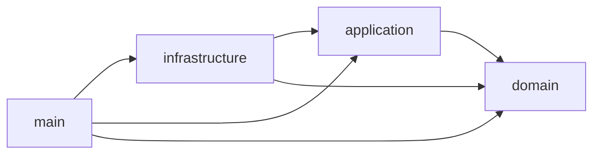

# Caso de uso modelo — guia de extensão do backend

Este guia mostra como adicionar uma funcionalidade ao backend seguindo a clean architecture do projeto. A referência real é o **`CheckHealthUseCase`** (o `GET /health`): ele atravessa as quatro camadas com o mínimo de código, então serve de molde. Toda story de backend (autorizações, validação QR/NFC, eventos…) segue os mesmos passos.

## As camadas e a regra de dependência

```text
src/
├─ domain/          regras e contratos puros: entidades, value objects, erros, ports (interfaces)
├─ application/     casos de uso: orquestram o domínio através dos ports
├─ infrastructure/  adapters que implementam os ports (Prisma, MQTT, relógio, hash…)
├─ main/            composição: env, Express (rotas, middlewares), composition root, server
└─ shared/          utilitários sem regra de negócio (logger)
```



- `domain` não importa nenhuma outra camada nem `express`/`zod`.
- `application` importa só `domain` — nunca Express, Prisma ou mqtt.js.
- `infrastructure` não importa `main`.
- `main` é o único que conhece todo mundo e faz a montagem.

A regra é **verificada pelo ESLint** (`no-restricted-imports` em `backend/eslint.config.js`): um import na direção errada quebra o `npm run lint` e o CI.

## Passo a passo (com o `CheckHealth` como exemplo)

### 1. Port no domain — o que o caso de uso precisa do mundo externo

[`src/domain/ports/clock.ts`](../../backend/src/domain/ports/clock.ts)

```ts
export interface Clock {
  now(): Date;
}
```

Port é uma interface pequena, nomeada pelo que o domínio precisa (`AuthorizationRepository`, `TerminalNotifier`, `Clock`), não pela tecnologia (`PrismaThing`, `MqttThing`). Entidades e erros de domínio também moram aqui.

### 2. Caso de uso no application — a regra

[`src/application/health/check-health.use-case.ts`](../../backend/src/application/health/check-health.use-case.ts)

```ts
export class CheckHealthUseCase {
  constructor(
    private readonly clock: Clock,
    private readonly startedAt: Date,
    private readonly version: string,
  ) {}

  execute(): CheckHealthOutput { /* ... */ }
}
```

Convenções:

- Um arquivo por caso de uso: `application/<contexto>/<verbo-substantivo>.use-case.ts`, classe `<VerboSubstantivo>UseCase`.
- Dependências **pelo construtor**, tipadas pelos ports (nunca `new PrismaClient()` aqui dentro).
- Um método público `execute(input)`; tipos `XxxInput`/`XxxOutput` exportados ao lado.
- Regra violada → `throw` de um erro de `domain/errors` (`NotFoundError`, `ValidationError`, `ConflictError`, `UnauthorizedError`, `ForbiddenError`). Nada de `res.status(...)` ou código HTTP no caso de uso.
- Pode ser `async` — o Express 5 encaminha a rejeição ao error handler sozinho.

### 3. Adapter no infrastructure — a implementação do port

[`src/infrastructure/clock/system-clock.ts`](../../backend/src/infrastructure/clock/system-clock.ts)

```ts
export class SystemClock implements Clock {
  now(): Date { return new Date(); }
}
```

É aqui que entram Prisma (US-05), mqtt.js (US-04), bcrypt/JWT etc. O adapter `implements` o port — o compilador garante o contrato.

### 4. Rota/controller no main — a borda HTTP

[`src/main/http/routes/health.routes.ts`](../../backend/src/main/http/routes/health.routes.ts)

```ts
export function healthRoutes(checkHealth: CheckHealthUseCase): Router {
  const router = Router();
  router.get('/health', (_req, res) => {
    res.status(200).json(checkHealth.execute());
  });
  return router;
}
```

O controller é fino: **valida a entrada com Zod** (`schema.parse(req.body)` — um `ZodError` vira 400 automaticamente), chama `execute` e devolve o resultado. Sem regra de negócio aqui. Depois, registre o router em [`src/main/http/app.ts`](../../backend/src/main/http/app.ts).

### 5. Composition root — a montagem

[`src/main/composition-root.ts`](../../backend/src/main/composition-root.ts)

```ts
const clock = new SystemClock();
return {
  logger: createLogger(env.LOG_LEVEL),
  useCases: {
    checkHealth: new CheckHealthUseCase(clock, clock.now(), env.APP_VERSION ?? 'dev'),
  },
};
```

Único lugar com `new` de adapters. Injeção de dependência manual, sem container/framework.

### 6. Testes

- **Unitário do caso de uso** ([`tests/unit/check-health.use-case.test.ts`](../../backend/tests/unit/check-health.use-case.test.ts)): instancia o caso de uso com **fakes dos ports** (ex.: `FixedClock`). Sem Express, sem banco — rápido e determinístico. É aqui que mora a maior parte dos testes de regra.
- **Integração da rota** ([`tests/integration/http.test.ts`](../../backend/tests/integration/http.test.ts)): Supertest em `createApp(...)`, conferindo status e corpo HTTP.

## Erros: do domínio ao HTTP

O [`error-handler.ts`](../../backend/src/main/http/middlewares/error-handler.ts) converte tudo para um formato único:

```json
{ "error": { "code": "NOT_FOUND", "message": "Autorizacao nao encontrada", "details": {} } }
```

| Origem | Status | `code` |
|---|---|---|
| `ValidationError` (regra de negócio) | 422 | `VALIDATION_ERROR` |
| `NotFoundError` | 404 | `NOT_FOUND` |
| `ConflictError` | 409 | `CONFLICT` |
| `UnauthorizedError` / `ForbiddenError` | 401 / 403 | `UNAUTHORIZED` / `FORBIDDEN` |
| `ZodError` (entrada malformada na borda) | 400 | `INVALID_REQUEST` (+ `details` por campo) |
| JSON inválido no body | 400 | `INVALID_JSON` |
| Rota inexistente | 404 | `ROUTE_NOT_FOUND` |
| Qualquer outro erro | 500 | `INTERNAL_ERROR` — detalhe só no log, nunca na resposta |

Erro de domínio novo: crie a subclasse em `domain/errors/domain-error.ts` com um `code` próprio e registre o status em `STATUS_BY_DOMAIN_CODE` no error handler (sem registro, vira 400).

## Variáveis de ambiente

[`src/main/config/env.ts`](../../backend/src/main/config/env.ts) é o **único** lugar que lê `process.env`. Variável nova: adicione ao schema Zod, ao [`backend/.env.example`](../../backend/.env.example) e receba-a via `Env` no composition root — nunca leia `process.env` direto num caso de uso ou adapter. Valor inválido derruba o boot com mensagem citando a variável.

## Checklist de um caso de uso novo

- [ ] Port(s) e erros em `domain/`
- [ ] `XxxUseCase` em `application/<contexto>/`, dependências pelo construtor
- [ ] Adapter(s) em `infrastructure/` implementando os ports
- [ ] Rota com validação Zod em `main/http/routes/`, registrada no `app.ts`
- [ ] Montagem no `composition-root.ts`
- [ ] Teste unitário do caso de uso com fakes + teste de integração da rota
- [ ] `npm run lint && npm run typecheck && npm test` verdes
- [ ] `docs/api/openapi.yaml` atualizado quando a rota for pública (a partir da US-06)
