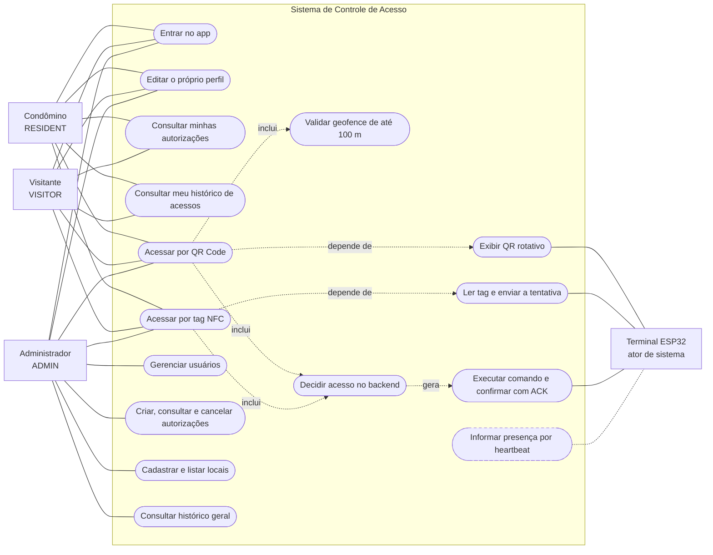

# Casos de uso

Quem usa o sistema e o que cada um consegue fazer, conferido contra as rotas da API (`backend/src/main/http/routes/`), os papéis do banco (`UserRole` em `backend/prisma/schema.prisma`) e o firmware (`firmware/src/`). Retrato da `main` em 23/11/2026.

Os perfis de pessoa são os do banco: **Administrador** (`ADMIN`), **Condômino** (`RESIDENT`) e **Visitante** (`VISITOR`). O **Terminal** (ESP32) é um ator de sistema: fala só MQTT e nunca decide acesso sozinho.

## Diagrama

O Mermaid não tem notação UML própria de casos de uso. Aqui os atores são os nós retangulares fora da fronteira, os casos de uso são as elipses dentro de `Sistema de Controle de Acesso`, e as linhas tracejadas marcam o que ainda não está implementado.

## Onde cada caso de uso está

| Caso de uso | Ator | Entrada no sistema | Story |
|---|---|---|---|
| Entrar no app | todos | `POST /api/v1/auth/login`, `GET /api/v1/auth/me` | US-14, US-27 |
| Editar o próprio perfil | todos | `PATCH /api/v1/me` | US-14 |
| Consultar minhas autorizações | condômino, visitante | `GET /api/v1/me/authorizations` | US-18, US-28 |
| Consultar meu histórico de acessos | condômino, visitante | `GET /api/v1/me/access-events` | US-21 |
| Acessar por QR Code | condômino, visitante (e admin, se tiver autorização) | app escaneia o QR do terminal e chama `POST /api/v1/access-events/qr` | US-19, US-20, US-29 |
| Acessar por tag NFC | condômino, visitante (e admin, se tiver autorização) | tag no RC522 → MQTT `terminals/{id}/access-events` | US-23 |
| Validar geofence de até 100 m | incluído no QR | `decideAccess` com `min(location.radiusMeters, 100)` | US-20, DT-23 |
| Decidir acesso no backend | incluído no QR e no NFC | `DecideAccessUseCase` (`backend/src/application/access/`) | US-19, US-23 |
| Gerenciar usuários | administrador | `GET/POST /api/v1/users`, `GET/PATCH/DELETE /api/v1/users/:id` | US-15, US-31 |
| Criar, consultar e cancelar autorizações | administrador | `GET/POST /api/v1/authorizations`, `POST /api/v1/authorizations/:id/cancel` | US-16, US-17, US-30 |
| Cadastrar e listar locais | administrador (listar: qualquer usuário autenticado) | `POST /api/v1/locations`, `GET /api/v1/locations` | US-39 |
| Consultar histórico geral | administrador | `GET /api/v1/access-events` | US-21, US-31 |
| Exibir QR rotativo | terminal | recebe `terminals/{id}/qr` do worker e desenha no display | US-22 |
| Ler tag e enviar a tentativa | terminal | `terminal_nfc::update` → `publishNfc` | US-23 |
| Executar comando e confirmar com ACK | terminal | recebe `terminals/{id}/commands`, publica `terminals/{id}/acks` | US-08, US-26 |
| Informar presença por heartbeat | terminal | `terminals/{id}/status` com LWT — **pendente** | US-24 |

## Limites e decisões que o diagrama reflete

- **Quem cria autorização é só o administrador.** O app descreve o visitante como "acesso temporário liberado por um morador", mas a rota `POST /authorizations` exige `requireAdmin`. O condômino não cria autorização para visitante. O diagrama segue o código.
- **A tag NFC não é cadastrada pelo app nem pela API.** A credencial NFC entra pelo seed ou pelos scripts de provisionamento (`backend/prisma/seed.ts`, `provision.ts`). Por isso não aparece um caso de uso "cadastrar tag".
- **O QR negado não chega ao terminal.** No QR, o resultado volta para o app na resposta HTTP. Só a decisão `GRANTED` grava um comando `open`. No NFC, o worker publica `open` ou `deny`, porque o terminal é a única interface de quem encostou a tag.
- **Heartbeat pendente (US-24).** O firmware ainda não publica `status` nem registra LWT. Hoje o worker passa a considerar o terminal online quando recebe dele uma tentativa NFC (`TerminalMessageRouter`), e só então envia o QR rotativo. Em simulação, o status é publicado pelo `sim-terminal`.

Fluxos detalhados em [`sequencias.md`](sequencias.md) e peças do sistema em [`componentes-implantacao.md`](componentes-implantacao.md).
