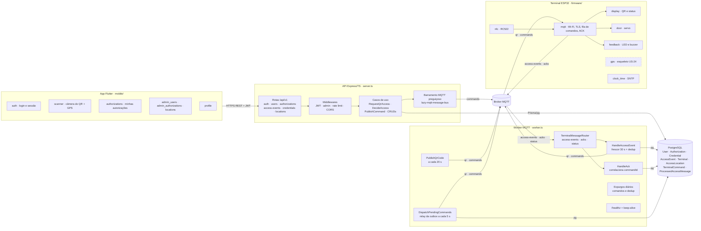
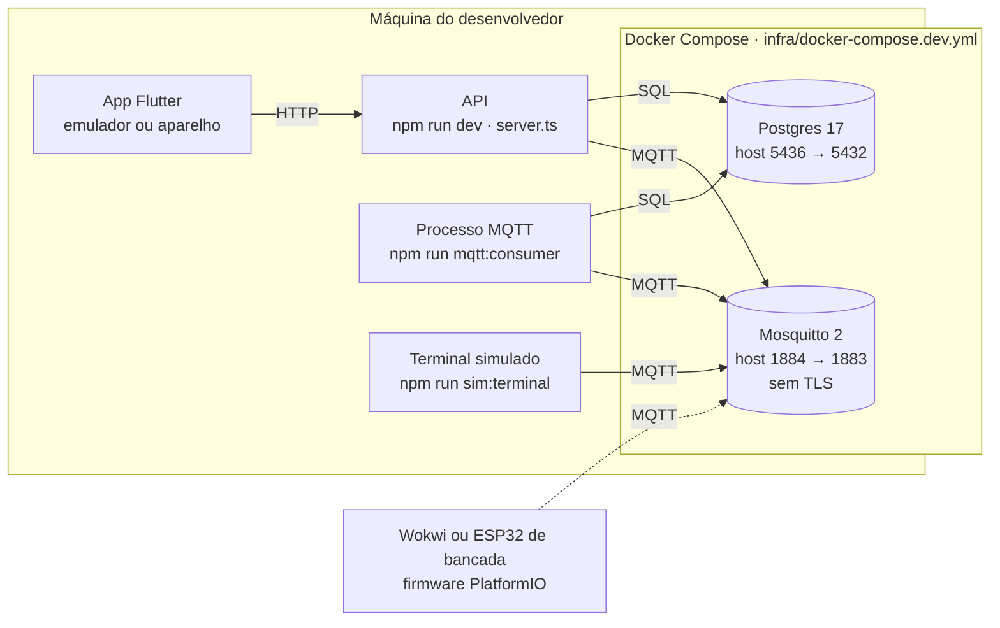
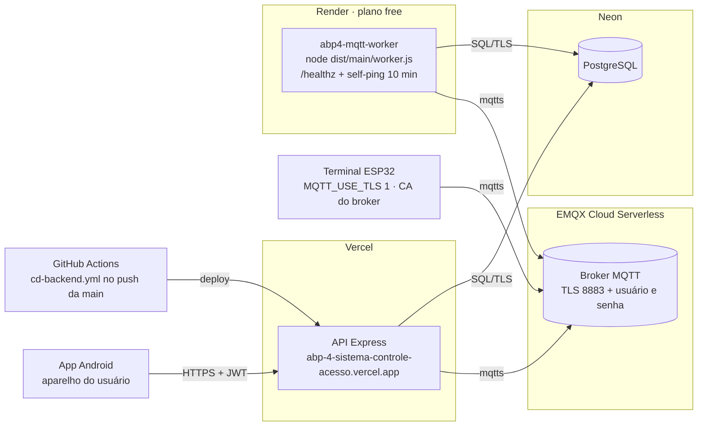

# Componentes e implantação

Peças do sistema, como elas conversam e onde cada uma roda em desenvolvimento e em produção. Conferido contra a `main` em 23/11/2026: `backend/src/main/` (composição da API e do worker), `firmware/src/`, `mobile/lib/features/`, `infra/docker-compose.dev.yml`, `render.yaml` e `.github/workflows/cd-backend.yml`.

## Diagrama de componentes

A API e o worker são **dois processos do mesmo código** (`backend/`), montados por composition roots diferentes. Os dois usam os mesmos casos de uso e o mesmo PostgreSQL. A API atende o app por HTTPS; o worker fica conectado ao broker o tempo todo.

### Responsabilidade de cada componente

| Componente | Faz | Não faz |
|---|---|---|
| App Flutter | Login, leitura do QR pela câmera, envio do token + posição GPS, telas de administração e histórico | Não decide acesso nem fala MQTT |
| API (Vercel) | Autentica, valida o pedido QR, decide, grava evento + consumo + comando na mesma transação e tenta publicar o comando | Não recebe mensagens do terminal |
| Worker (Render) | Recebe tentativas NFC, ACKs e status; publica QR rotativo e comandos; reentrega comandos pendentes (outbox) | Não atende o app |
| Broker | Entrega as mensagens MQTT v1 com QoS 1 e TLS em produção | Não guarda comandos (sem retain) |
| PostgreSQL | Fonte única de usuários, autorizações, eventos, outbox de comandos (`TerminalCommand`) e dedup (`ProcessedAccessMessage`) | — |
| Terminal ESP32 | Mostra o QR, lê a tag, executa o comando válido, sinaliza e confirma com ACK | Nunca decide acesso. Sem hora confiável, recusa o comando (`clock_unsynced`) |

Tópicos, payloads e QoS: [`contratos-mqtt.md`](contratos-mqtt.md). Tabelas: [`modelo-dados.md`](modelo-dados.md). Camadas internas do backend: [`caso-de-uso-modelo.md`](caso-de-uso-modelo.md).

## Implantação em desenvolvimento

Tudo roda na máquina do desenvolvedor. Broker e banco sobem pelo compose. API e worker rodam com `npm` dentro de `backend/`. O terminal pode ser o simulador Node ou o firmware no Wokwi ou no ESP32 da bancada.

Passo a passo: [`../guides/como-rodar.md`](../guides/como-rodar.md).

## Implantação em produção

| Peça | Onde | Como é publicada | Observado |
|---|---|---|---|
| API | Vercel | CD do GitHub Actions a cada push na `main` | `/health` com `database: ok` (11/11) |
| Worker | Render (`render.yaml`) | Blueprint; segredos no painel (`sync: false`) | LIVE com `mqtt conectado` no EMQX TLS (11/11, [`us-37.md`](../entrega/evidencias/us-37.md)) |
| Banco | Neon | `prisma migrate deploy` no CD da API, antes da promoção | — |
| Broker | EMQX Cloud Serverless | Painel do EMQX | TLS 8883 |
| Terminal | ESP32 físico | Build PlatformIO com `MQTT_USE_TLS 1` | Conexão e certificado validados no ESP32 (06/11, [`dt-06.md`](../entrega/evidencias/dt-06.md)) |
| App | Android | APK gerado e validado no `ci-mobile` (DT-10) | Executado em aparelho físico ([`us-29-aparelho.md`](../entrega/evidencias/us-29-aparelho.md)) |

Limites que valem para produção:

- **O relay da outbox roda só entre 18:45 e 23:05**, no fuso `America/Sao_Paulo` (DT-21). Fora da janela, comando que falhou na primeira publicação não é reentregue (e já teria vencido os 10 s de prazo).
- **O Render free dorme sem tráfego.** O self-ping de 10 min mantém o worker acordado; a continuidade não foi medida.
- **Uma réplica de worker é o caso previsto**, mas o relay e a dedup usam reserva no banco e aguentam duas.

Detalhes de deploy: [`../guides/deploy.md`](../guides/deploy.md) e [`adr/001-provisionamento-vercel-neon.md`](adr/001-provisionamento-vercel-neon.md).
