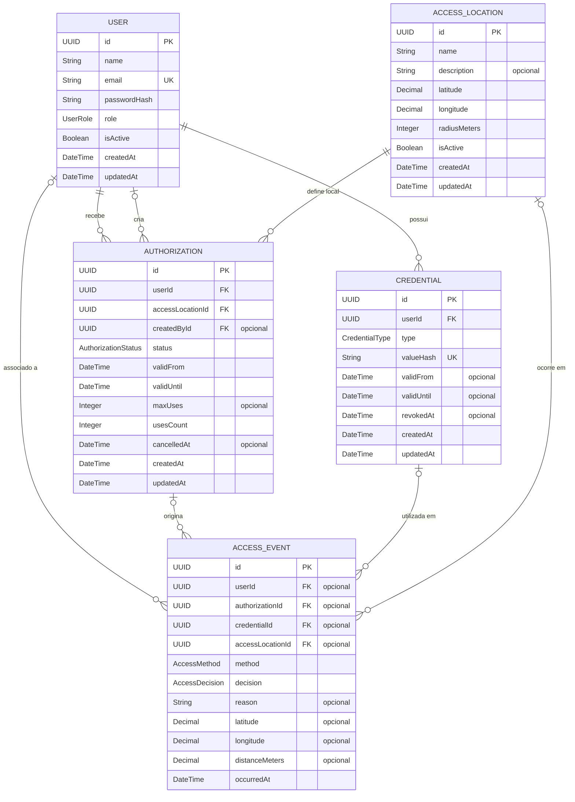

# Modelo de dados v1

Diagrama entidade-relacionamento do backend, alinhado ao [`schema.prisma`](../../backend/prisma/schema.prisma). IDs são UUIDs; datas são armazenadas como `DateTime` no PostgreSQL. Campos marcados como FK representam as relações entre entidades.

## Regras e enums

- Cada autorização pertence a um usuário e a um local. `createdById` registra o administrador que a criou quando conhecido.
- Uma autorização pode ter limite de usos (`maxUses`); `usesCount` começa em zero. A validade fica entre `validFrom` e `validUntil`.
- Cada credencial pertence a um usuário. `valueHash` guarda o hash do token QR ou do UID NFC, e nunca o valor original.
- Eventos preservam o resultado (`ALLOWED` ou `DENIED`), método (`QR` ou `NFC`), motivo e coordenadas recebidas. As relações com usuário, autorização, credencial e local são opcionais para registrar tentativas sem identificação completa.
- Exclusão de usuário, local e credencial referenciados por autorizações é restringida. Ao excluir uma entidade referenciada por um evento, a FK do evento é anulada para preservar o histórico.
- `UserRole`: `USER`, `ADMIN` · `AuthorizationStatus`: `ACTIVE`, `CANCELLED` · `CredentialType` e `AccessMethod`: `QR`, `NFC` · `AccessDecision`: `ALLOWED`, `DENIED`.

## Campos espaciais

`AccessLocation.latitude` e `longitude` são coordenadas do local; `radiusMeters` define a distância máxima permitida para o geofence (100 m por padrão). As coordenadas e `distanceMeters` do evento registram a posição informada na tentativa de acesso.
