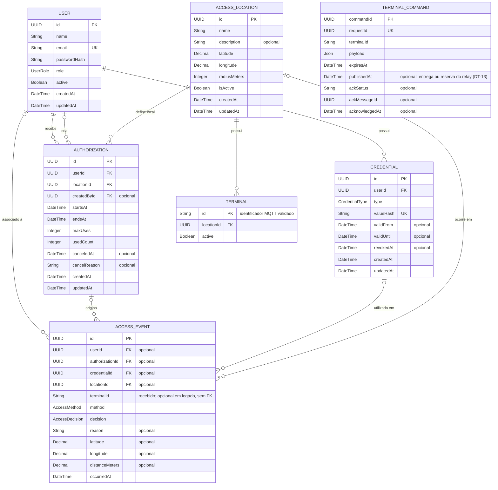

# Modelo de dados v1

Diagrama entidade-relacionamento do backend, alinhado ao [`schema.prisma`](../../backend/prisma/schema.prisma) e ao contrato REST v1 (US-06). IDs são UUIDs; datas são armazenadas como `DateTime` no PostgreSQL. Campos marcados como FK representam as relações entre entidades.

Os nomes de tabela e de campo acompanham o contrato REST (ex.: `active`, `startsAt`, `usedCount`, `locationId`, `canceledAt`) para o mapeamento entre API e banco não depender de tradução.

## Situação da autorização

`SCHEDULED`, `ACTIVE`, `EXPIRED` e `CANCELED` **não são colunas**: a situação é derivada de `canceledAt`, `startsAt`/`endsAt` e `maxUses`/`usedCount`, na ordem abaixo.

1. `canceledAt` preenchido → `CANCELED`.
2. `usedCount >= maxUses` ou agora depois de `endsAt` → `EXPIRED`.
3. agora antes de `startsAt` → `SCHEDULED`.
4. caso contrário → `ACTIVE`.

Persistir só os fatos (janela, contador e cancelamento) evita linha `ACTIVE` vencida no banco e dispensa rotina agendada para virar `EXPIRED`.

## Regras e enums

- Cada autorização pertence a um usuário e a um local. `createdById` registra o administrador que a criou quando conhecido.
- `maxUses` é obrigatório (limite de utilizações na janela); `usedCount` começa em zero. `CancelAuthorizationRequest.reason` é gravado em `cancelReason`.
- Cada credencial pertence a um usuário. `valueHash` guarda o hash do token QR ou do UID NFC, e nunca o valor original.
- A senha é gravada no formato `scrypt$N$r$p$salt$hash` ([`password-hasher.ts`](../../backend/src/shared/password-hasher.ts)). Cadastro real (inclusive `npm run db:provision`) usa salt aleatório; a seed de demonstração usa salt determinístico para poder ser reexecutada. A seed demo só roda em banco local e nunca em produção; o primeiro administrador real vem de `db:provision` (ver [como rodar](../guides/como-rodar.md#seed-demo--provisionamento-real-dt-07)).
- Eventos preservam o resultado (`GRANTED` ou `DENIED`), método (`QR` ou `NFC`), motivo e coordenadas recebidas. As relações com usuário, autorização, credencial e local são opcionais para registrar tentativas sem identificação completa. O motivo segue o enum `DenialReason` do contrato e é `null` quando o acesso é concedido.
- `locationId` do evento é opcional no banco e `location` aceita `null` na API. Terminal desconhecido gera negativa consultável (`UNKNOWN_TERMINAL`) com seu identificador original em `terminalId`, sem FK obrigatória que impediria a auditoria. Eventos legados preservam `terminalId: null`.
- `Terminal` associa o identificador MQTT ao local com FK obrigatória. O banco valida o formato do identificador; terminal e local devem estar ativos para conceder acesso. Sem mapeamento, não há abertura.
- `TerminalCommand` é compartilhado por API e worker. A intenção de comando é gravada na mesma transação do evento e do consumo, com prazo ancorado no instante da decisão; o ACK atualiza atomicamente somente o comando do terminal correspondente e não sobrescreve um resultado anterior. `requestId` único preserva comando e validade em retentativas. `publishedAt` (`null` até a entrega, ver [`schema.prisma`](../../backend/prisma/schema.prisma)) marca a outbox: o relay reserva pelo campo antes de publicar e o atualiza no PUBACK (DT-13). Não tem FK de terminal, permitindo persistir comandos de negativa para terminais desconhecidos.
- Consumo de autorização e evento são transacionais. Locks por tentativa e autorização evitam duplicar consumo entre instâncias; uma negativa nunca incrementa o contador.

  A decisão **não carrega nem bloqueia o histórico** (DT-17): a consulta traz as autorizações que ainda podem valer — `canceledAt IS NULL`, `usedCount < maxUses` e `endsAt >= agora` — na ordem de escolha `(endsAt, id)`, com `FOR UPDATE`, apoiada no índice `Authorization_userId_locationId_endsAt_id_idx`. Canceladas, esgotadas e já terminadas ficam fora da leitura e do lock. Não há filtro de `startsAt`: a política revalida o instante **depois** da espera pelo lock, então uma autorização que começa durante a espera continua sendo julgada validamente. A primeira linha da ordem de escolha sobre **todas** as autorizações acompanha a lista, porque é dela que a política tira o motivo da negativa (`authorizations[0]`). Assim a decisão e o motivo são os mesmos da leitura completa anterior, sem ler o histórico. O `UPDATE` condicional do consumo continua sendo a garantia final do último uso.
- Os `DateTime` persistidos pelo Prisma usam UTC. O adapter SQL converte `TIMESTAMP` sem fuso para UTC ao ler e grava strings ISO UTC; filtros com offset são normalizados. Isso preserva janelas e validade do QR entre API e worker com fusos diferentes.
- Exclusão de usuário, local e credencial referenciados por autorizações é restringida. Ao excluir uma entidade referenciada por um evento, a FK do evento é anulada para preservar o histórico.
- `UserRole`: `ADMIN`, `RESIDENT`, `VISITOR` · `CredentialType` e `AccessMethod`: `QR`, `NFC` · `AccessDecision`: `GRANTED`, `DENIED`.

## Campos espaciais

`AccessLocation.latitude` e `longitude` são coordenadas do local; `radiusMeters` define a distância máxima permitida para o geofence (100 m por padrão). As coordenadas e `distanceMeters` do evento registram a posição informada na tentativa de acesso. `distanceMeters` usa `Decimal(10,2)` para registrar também negativas a milhares de quilômetros, sem estouro numérico.

## Retencao da deduplicacao

`ProcessedAccessMessage` guarda uma linha por `messageId` processado. A retencao e de **24 h depois de `processedAt`** (`DEDUP_RETENTION_MS` em [`dedup-retention.ts`](../../backend/src/domain/terminal/dedup-retention.ts)), DT-15.

- **Por que 24 h basta**: o worker rejeita por frescor **antes** de deduplicar (`isFreshAccessEvent`: idade menor que 30 s e no maximo 5 s no futuro). Uma retransmissao QoS 1 so chega a deduplicacao ate ~35 s depois da primeira entrega; 24 h e mais de 2000x isso e absorve desvio de relogio entre terminal, workers e banco. Uma mensagem expurgada ja seria descartada como antiga antes de consultar a tabela.
- **Margem de relogio**: o corte e calculado no banco (`LOCALTIMESTAMP - 24 h`), mesmo relogio e fuso do `DEFAULT` que grava `processedAt`; o relogio do worker nao entra na conta.
- **Expurgo**: `PurgeProcessedMessagesUseCase` roda no boot do worker e a cada 24 h, em lotes de 500 com teto de 10 lotes por execucao, usando o indice `ProcessedAccessMessage_processedAt_idx`. Usa a pool da deduplicacao (uma conexao por `DELETE` curto). Falha vira log de erro e nao derruba o processo MQTT.
- **Onde ver**: cada execucao registra `expurgo da deduplicacao concluido` com `removed`, `rows` e `bytes` (contagem e `pg_total_relation_size` da tabela apos o expurgo). O `/healthz` do worker devolve o ultimo resultado em `dedupPurge` (`at`, `status` e os mesmos campos, ou `error`), lido da memoria: o self-ping nao gera consulta ao banco.
- **Mensagem ainda elegivel continua deduplicada**: coberto em `tests/integration/postgres-event-deduplicator.test.ts` (marca recente sobrevive ao expurgo e o replay devolve `duplicate`).

## Retencao do comando do terminal

`TerminalCommand` guarda o payload publicado, o prazo, o resultado do ACK e a correlacao usada pelo worker. A retencao e de **7 dias depois de `expiresAt`** (`COMMAND_RETENTION_MS` em [`command-retention.ts`](../../backend/src/domain/terminal/command-retention.ts)), muito acima do prazo de 10 s do comando e da janela de frescor de 30 s: cobre ACK tardio, reinicio do worker e investigacao de uma abertura.

- **Comandos com ACK**: a linha permanece 7 dias depois de expirar, com `ackStatus`, `ackMessageId`, `ackReason` e `acknowledgedAt`. Um ACK repetido continua devolvendo `duplicate`.
- **Comandos sem ACK**: a linha expira e sai no mesmo prazo. O ACK que chegar depois do expurgo devolve `unknown` (nada e reaberto); o worker registra a falha de correlacao no log.
- **Expurgo**: `PurgeExpiredCommandsUseCase` roda no boot do worker e a cada 24 h, em lotes de 500 com teto de 10 lotes por execucao, usando o indice `TerminalCommand_expiresAt_idx`. Cada execucao registra `expurgo de comandos concluido` com o total removido; falha vira log de erro e nao derruba o processo MQTT.
- **Por que nao reabre acesso**: a idempotencia da tentativa e o `AccessEvent` (o `requestId` vira o id do evento), nao o `TerminalCommand`. Apos o expurgo, repetir o pedido devolve o evento ja gravado sem consumir autorizacao de novo, e o `expiresAt` do comando segue ancorado no instante da decisao — `PublishCommandUseCase` responde `published: false` em vez de abrir. Coberto em `tests/integration/postgres-command-store.test.ts`.

