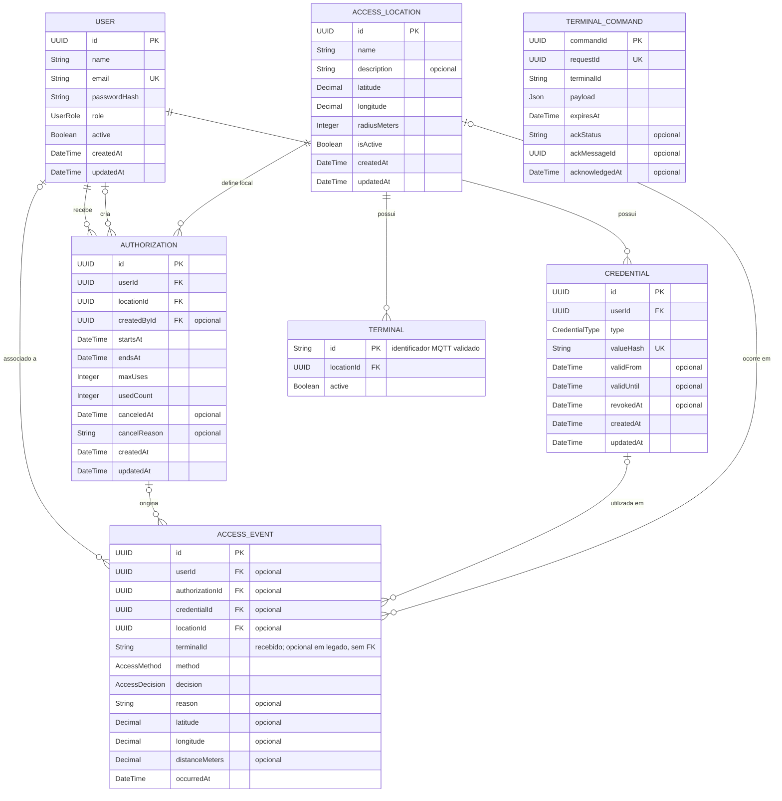

# Modelo de dados v1

Diagrama entidade-relacionamento do backend, alinhado ao [`schema.prisma`](../../backend/prisma/schema.prisma) e ao contrato REST v1 (US-06). IDs são UUIDs; datas são armazenadas como `DateTime` no PostgreSQL. Campos marcados como FK representam as relações entre entidades.

Os nomes de tabela e de campo acompanham o contrato REST (ex.: `active`, `startsAt`, `usedCount`, `locationId`, `canceledAt`) para o mapeamento entre API e banco não depender de tradução.

## Situação da autorização

`SCHEDULED`, `ACTIVE`, `EXPIRED` e `CANCELED` **não são colunas**: a situação é derivada de `canceledAt`, `startsAt`/`endsAt` e `maxUses`/`usedCount`, na ordem abaixo.

1. `canceledAt` preenchido → `CANCELED`.
2. `usedCount >= maxUses` ou agora depois de `endsAt` → `EXPIRED`.
3. agora antes de `startsAt` → `SCHEDULED`.
4. caso contrário → `ACTIVE`.

Persistir só os fatos (janela, contador e cancelamento) evita linha `ACTIVE` vencida no banco e dispensa rotina agendada para virar `EXPIRED`.

## Regras e enums

- Cada autorização pertence a um usuário e a um local. `createdById` registra o administrador que a criou quando conhecido.
- `maxUses` é obrigatório (limite de utilizações na janela); `usedCount` começa em zero. `CancelAuthorizationRequest.reason` é gravado em `cancelReason`.
- Cada credencial pertence a um usuário. `valueHash` guarda o hash do token QR ou do UID NFC, e nunca o valor original.
- A senha é gravada no formato `scrypt$N$r$p$salt$hash` ([`password-hasher.ts`](../../backend/src/shared/password-hasher.ts)). Cadastro real (inclusive `npm run db:provision`) usa salt aleatório; a seed de demonstração usa salt determinístico para poder ser reexecutada. A seed demo só roda em banco local e nunca em produção; o primeiro administrador real vem de `db:provision` (ver [como rodar](../guides/como-rodar.md#seed-demo--provisionamento-real-dt-07)).
- Eventos preservam o resultado (`GRANTED` ou `DENIED`), método (`QR` ou `NFC`), motivo e coordenadas recebidas. As relações com usuário, autorização, credencial e local são opcionais para registrar tentativas sem identificação completa. O motivo segue o enum `DenialReason` do contrato e é `null` quando o acesso é concedido.
- `locationId` do evento é opcional no banco e `location` aceita `null` na API. Terminal desconhecido gera negativa consultável (`UNKNOWN_TERMINAL`) com seu identificador original em `terminalId`, sem FK obrigatória que impediria a auditoria. Eventos legados preservam `terminalId: null`.
- `Terminal` associa o identificador MQTT ao local com FK obrigatória. O banco valida o formato do identificador; terminal e local devem estar ativos para conceder acesso. Sem mapeamento, não há abertura.
- `TerminalCommand` é compartilhado por API e worker. A intenção de comando é gravada na mesma transação do evento e do consumo, com prazo ancorado no instante da decisão; o ACK atualiza atomicamente somente o comando do terminal correspondente e não sobrescreve um resultado anterior. `requestId` único preserva comando e validade em retentativas. Não tem FK de terminal, permitindo persistir comandos de negativa para terminais desconhecidos.
- Consumo de autorização e evento são transacionais. Locks por tentativa e autorização evitam duplicar consumo entre instâncias; uma negativa nunca incrementa o contador.

  A decisão **não carrega nem bloqueia o histórico** (DT-17): a consulta traz as autorizações que ainda podem valer — `canceledAt IS NULL`, `usedCount < maxUses` e `endsAt >= agora` — na ordem de escolha `(endsAt, id)`, com `FOR UPDATE`, apoiada no índice `Authorization_userId_locationId_endsAt_id_idx`. Canceladas, esgotadas e já terminadas ficam fora da leitura e do lock. Não há filtro de `startsAt`: a política revalida o instante **depois** da espera pelo lock, então uma autorização que começa durante a espera continua sendo julgada validamente. A primeira linha da ordem de escolha sobre **todas** as autorizações acompanha a lista, porque é dela que a política tira o motivo da negativa (`authorizations[0]`). Assim a decisão e o motivo são os mesmos da leitura completa anterior, sem ler o histórico. O `UPDATE` condicional do consumo continua sendo a garantia final do último uso.
- Os `DateTime` persistidos pelo Prisma usam UTC. O adapter SQL converte `TIMESTAMP` sem fuso para UTC ao ler e grava strings ISO UTC; filtros com offset são normalizados. Isso preserva janelas e validade do QR entre API e worker com fusos diferentes.
- Exclusão de usuário, local e credencial referenciados por autorizações é restringida. Ao excluir uma entidade referenciada por um evento, a FK do evento é anulada para preservar o histórico.
- `UserRole`: `ADMIN`, `RESIDENT`, `VISITOR` · `CredentialType` e `AccessMethod`: `QR`, `NFC` · `AccessDecision`: `GRANTED`, `DENIED`.

## Campos espaciais

`AccessLocation.latitude` e `longitude` são coordenadas do local; `radiusMeters` define a distância máxima permitida para o geofence (100 m por padrão). As coordenadas e `distanceMeters` do evento registram a posição informada na tentativa de acesso. `distanceMeters` usa `Decimal(10,2)` para registrar também negativas a milhares de quilômetros, sem estouro numérico.

## Retencao da deduplicacao

`ProcessedAccessMessage` guarda uma linha por `messageId` processado, sem TTL definido; o crescimento e linear ao volume de tentativas. Acompanhar o tamanho da tabela e, se necessario, definir expurgo por `processedAt` (com indice) preservando a idempotencia das mensagens ainda em transito.
