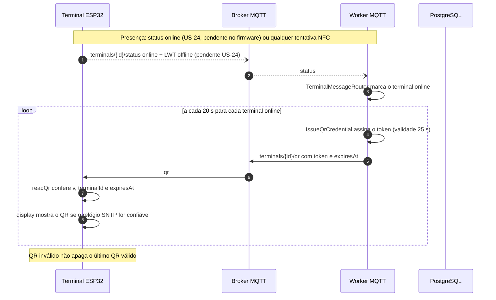
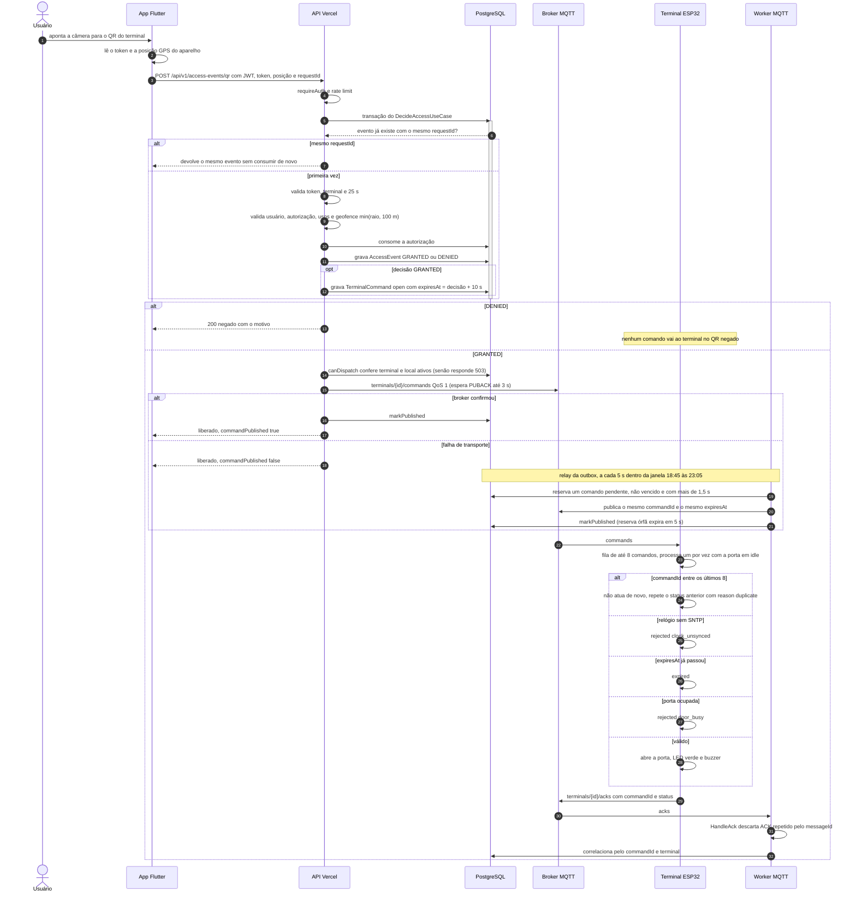
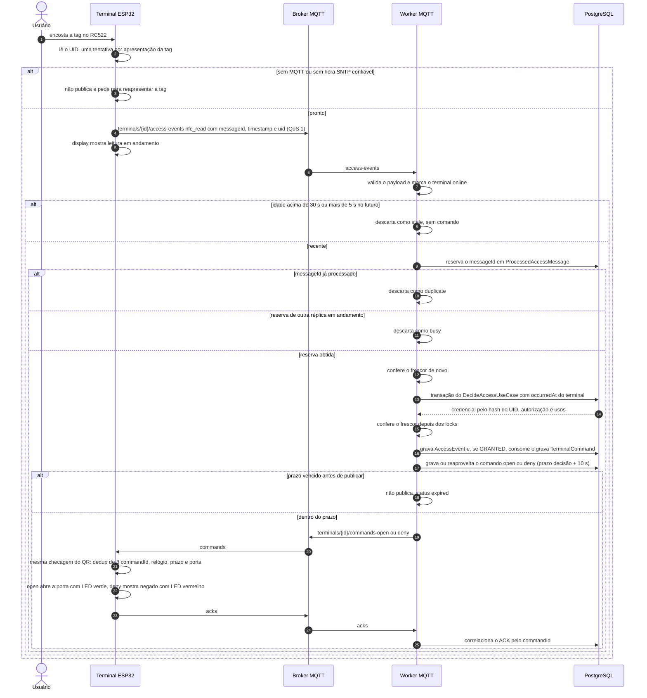

# Sequências de acesso

Ordem das mensagens nos três fluxos que envolvem o terminal: a rotação do QR, o acesso por QR e o acesso por NFC. Cada passo cita a classe ou constante que o implementa na `main` (23/11/2026), para que o diagrama possa ser conferido contra o código.

## Prazos e proteções que aparecem nos fluxos

| Regra | Valor | Onde está |
|---|---|---|
| Validade do QR | 25 s | `QR_TTL_MS` em `backend/src/domain/terminal/messages.ts` |
| Intervalo de publicação do QR | 20 s | `QR_INTERVAL_MS` em `backend/src/main/mqtt/worker-runtime.ts` |
| Prazo do comando | 10 s a partir da decisão | `COMMAND_TTL_MS` em `messages.ts` |
| Frescor da tentativa NFC | até 30 s de idade e até 5 s no futuro | `event-freshness.ts` |
| Dedup da tentativa NFC | por `messageId`, com reserva no PostgreSQL | `ProcessedAccessMessage`, `postgres-event-deduplicator.ts` |
| Dedup do ACK | por `messageId`, em memória do worker | `SeenMessages` |
| Dedup do comando no terminal | últimos 8 `commandId` | `kCapacity` em `firmware/include/command.h` |
| Relay da outbox | a cada 5 s, só entre 18:45 e 23:05 | `COMMAND_RELAY_INTERVAL_MS`, DT-21 |
| Folga antes de republicar | 1,5 s | `DISPATCH_GRACE_MS` |
| Reserva órfã do relay | expira em 5 s | `CLAIM_STALE_MS` |
| Espera pelo PUBACK do broker | 3 s | `PUBLISH_TIMEOUT_MS` |

## 1. Rotação do QR no terminal

O worker só publica QR para terminais que ele considera online. Sem o heartbeat da US-24, isso acontece quando o terminal envia uma tentativa NFC, ou quando o simulador publica `status: online`.

## 2. Acesso por QR

O app lê o QR do display e manda o pedido por HTTPS. A API decide e grava tudo numa transação. Se a publicação do comando falhar, o relay do worker entrega o **mesmo** comando, com o mesmo `commandId` e o mesmo prazo.

## 3. Acesso por NFC

A tentativa vai do terminal ao worker por MQTT. Ela só é aceita enquanto é recente: o worker confere o frescor antes da dedup, depois da reserva e de novo dentro da transação de decisão. O terminal não guarda tentativas para mandar depois: sem rede ou sem hora confiável, a leitura é recusada e a pessoa reapresenta a tag (fila offline é a US-25).

## O que os diagramas não garantem

- **Abertura física.** A decisão `GRANTED` é autorização. A confirmação de que a porta abriu é o ACK `executed`, e o servo físico ainda não foi demonstrado de ponta a ponta (US-34).
- **Heartbeat e LWT.** Desenhados como pendentes: o firmware da `main` não publica `status` (US-24).
- **Entrega garantida.** MQTT com QoS 1 é *at-least-once*. Por isso há dedup nos três pontos (tentativa, comando e ACK). O relay só cobre comandos ainda dentro dos 10 s.

Contratos dos payloads em [`contratos-mqtt.md`](contratos-mqtt.md). Visão geral em [`visao-geral.md`](visao-geral.md).
