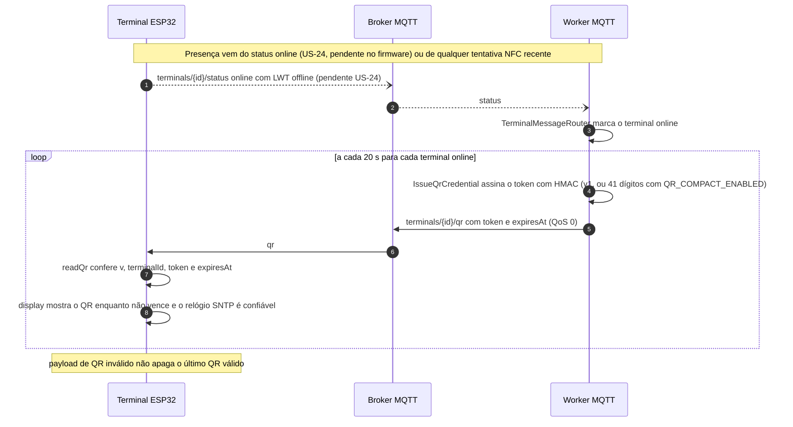
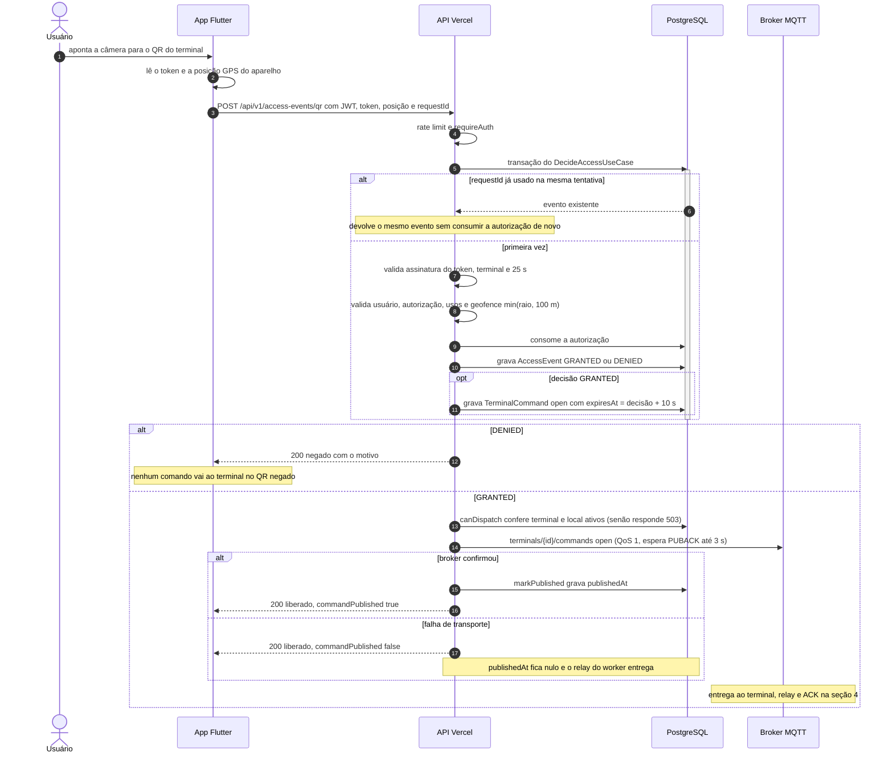
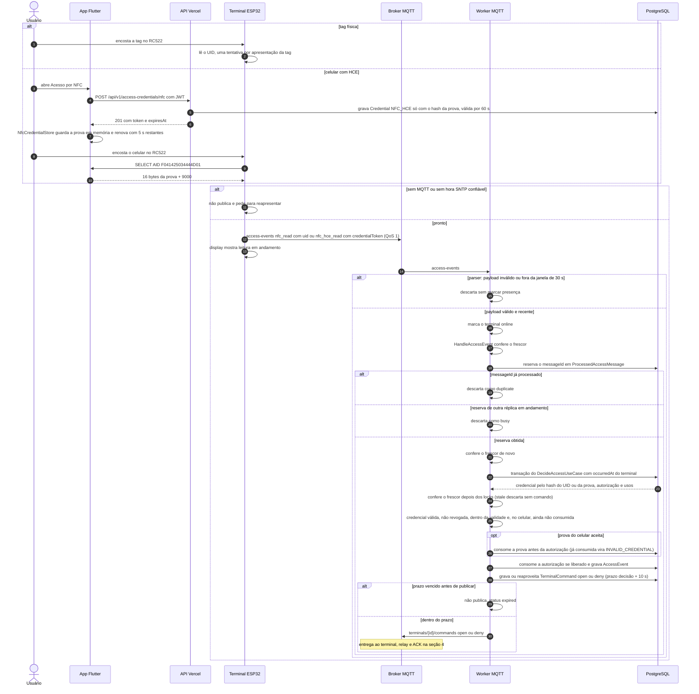
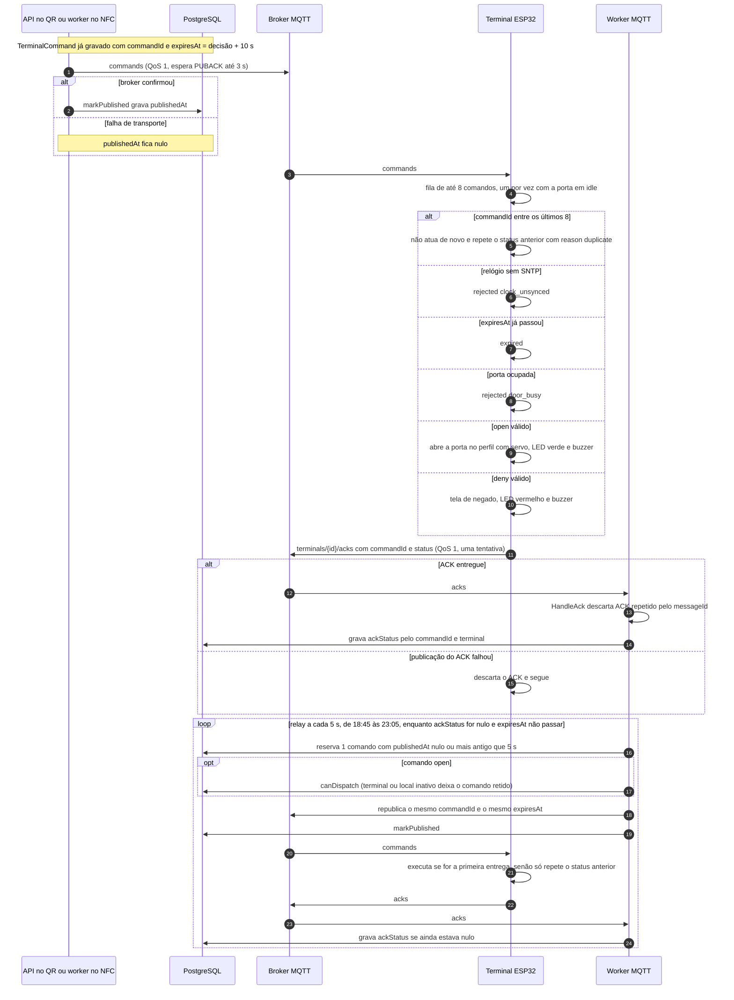

# Sequências de acesso

Ordem das mensagens nos fluxos que envolvem o terminal: a rotação do QR, o acesso por QR, o acesso por NFC (tag física e celular) e a entrega do comando até o ACK, que é comum aos dois métodos. Cada passo cita a classe ou constante que o implementa na `main` em `349575d` (24/11/2026), para que o diagrama possa ser conferido contra o código.

## Prazos e proteções que aparecem nos fluxos

| Regra | Valor | Onde está |
|---|---|---|
| Validade do QR | 25 s | `QR_TTL_MS` em `backend/src/domain/terminal/messages.ts` |
| Intervalo de publicação do QR | 20 s, QoS 0 | `QR_INTERVAL_MS` em `backend/src/main/mqtt/worker-runtime.ts` |
| Validade da prova NFC do celular | 60 s, uso único | `NFC_CREDENTIAL_TTL_MS` em `issue-nfc-credential.use-case.ts`, `Credential.consumedAt` |
| Prazo do comando | 10 s a partir da decisão | `COMMAND_TTL_MS` em `messages.ts` |
| Frescor da tentativa NFC | idade abaixo de 30 s e até 5 s no futuro | `event-freshness.ts`, checado no parser e no caso de uso |
| Dedup da tentativa NFC | por `messageId`, com reserva no PostgreSQL | `ProcessedAccessMessage`, `postgres-event-deduplicator.ts` |
| Dedup do ACK | por `messageId`, em memória do worker | `SeenMessages` em `mqtt-composition-root.ts` |
| Dedup do comando no terminal | últimos 8 `commandId` | `kCapacity` em `firmware/include/command.h` |
| Relay da outbox | a cada 5 s, só entre 18:45 e 23:05 | `COMMAND_RELAY_INTERVAL_MS`, `RELAY_WINDOW_*` (DT-21) |
| Idade mínima da decisão antes do relay | 1,5 s | `DISPATCH_GRACE_MS` |
| Republicação sem ACK (e reserva órfã) | depois de 5 s | `CLAIM_STALE_MS` com `"publishedAt" < now - 5 s AND "ackStatus" IS NULL` em `postgres-command-store.ts` |
| Espera pelo PUBACK do broker | 3 s | `PUBLISH_TIMEOUT_MS` |

## 1. Rotação do QR no terminal

O worker só publica QR para terminais que ele considera online. Sem o heartbeat da US-24, isso acontece quando o terminal envia uma tentativa NFC recente, ou quando o simulador publica `status: online`. A lista fica em memória: se o worker reiniciar, o terminal só volta a receber QR depois de uma nova tentativa ou de um novo status.

## 2. Acesso por QR

O app lê o QR do display e manda o pedido por HTTPS. A API decide e grava tudo numa transação. A entrega do comando até o ACK segue a seção 4.

## 3. Acesso por NFC: tag física ou celular

As duas formas publicam no mesmo tópico `terminals/{id}/access-events` e passam pelo mesmo caso de uso. A tag manda o UID (`nfc_read`). O celular manda uma prova de 128 bits emitida pela API, válida por 60 s e de uso único (`nfc_hce_read`), nunca o UID do aparelho.

A tentativa só é aceita enquanto é recente. O frescor é conferido **quatro vezes**: no parser, no início do caso de uso, depois da reserva de dedup e dentro da transação, depois dos locks. Uma tentativa velha é descartada no parser e nem marca o terminal como online. O terminal não guarda tentativas para mandar depois: sem rede ou sem hora confiável, a pessoa precisa reapresentar a tag (fila offline é a US-25).

A leitura da prova HCE pelo ESP32 está no firmware (`SELECT AID` ISO-DEP, prova de 16 bytes + `9000`, publicação de `nfc_hce_read`).

## 4. Entrega do comando, relay da outbox e ACK

Vale para o QR (comando publicado pela API) e para o NFC (publicado pelo worker). Todo comando fica em `TerminalCommand` com `commandId` e `expiresAt` fixos. O relay do worker republica o **mesmo** comando enquanto não houver ACK e o prazo não vencer, inclusive quando a primeira publicação deu certo mas o ACK não chegou em 5 s. Por isso o terminal deduplica por `commandId`.

## O que os diagramas não garantem

- **Abertura física.** A decisão `GRANTED` é autorização. A confirmação de que a porta abriu é o ACK `executed`, e o servo físico ainda não foi demonstrado de ponta a ponta (US-34).
- **Heartbeat, LWT e leitura HCE no ESP32.** Desenhados, mas pendentes no firmware do repositório (US-24 e #77).
- **Entrega garantida.** MQTT com QoS 1 é *at-least-once*, e o terminal tenta publicar o ACK uma vez só. Quem cobre um ACK perdido é a republicação do relay, que só acontece dentro dos 10 s do comando e dentro da janela de operação. Por isso há dedup nos três pontos: tentativa, comando e ACK.

Contratos dos payloads em [`contratos-mqtt.md`](contratos-mqtt.md). Visão geral em [`visao-geral.md`](visao-geral.md).
