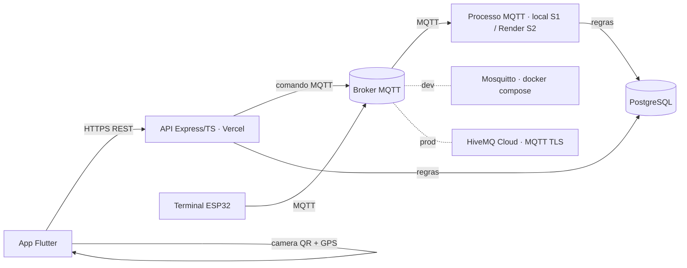

# Visão geral da arquitetura

O sistema controla o acesso de pessoas a um edifício em três frentes que conversam por rede: o **Terminal de Acesso** (ESP32) exibe um QR Code rotativo e lê tags NFC, publicando e recebendo comandos por MQTT; o **app móvel** (Flutter) autentica o usuário, escaneia o QR Code e envia a geolocalização; e o **backend** (Node + Express + TypeScript) concentra as regras de acesso, persiste os eventos em PostgreSQL e é a única fonte de decisão — o terminal nunca decide sozinho. Em desenvolvimento o broker é o Mosquitto do `infra/docker-compose.dev.yml` e o banco é o Postgres do mesmo compose; em produção a API roda no Vercel, o worker MQTT no Render, o banco no Neon e o broker é o HiveMQ Cloud com TLS (ver [`adr/001-provisionamento-vercel-neon.md`](adr/001-provisionamento-vercel-neon.md)).

## Diagrama

O modelo relacional persistido pelo backend está em [`modelo-dados.md`](modelo-dados.md).

**Transporte**: app ↔ API por **HTTPS REST**; terminal ↔ backend por **MQTT bidirecional**. Na S1 o processo MQTT do backend roda localmente (US-04); na S2 o mesmo processo vai para o Render (US-37). A Vercel hospeda só a API.

- **Dev**: broker Mosquitto local (porta `1884` no host, `1883` interna do container; sem TLS) e Postgres do compose — ver [`../guides/como-rodar.md`](../guides/como-rodar.md).
- **Prod**: HiveMQ Cloud (MQTT sobre TLS, com credenciais), Postgres no Neon, API no Vercel e processo MQTT no Render.

## Fluxo de acesso via QR

1. O processo MQTT do backend publica um QR Code rotativo (validade de 10 s) no tópico do terminal.
2. O terminal exibe o QR Code no display.
3. O usuário escaneia o QR Code com o app.
4. O app envia o token lido do QR (com o identificador do terminal), a credencial do usuário e a geolocalização à API (HTTPS REST).
5. A API valida o token do QR (formato, terminal e expiração de 10 s), a credencial do usuário, a janela de uso, o número de usos, o local e a distância (≤ 100 m).
6. O caso de uso grava a decisão e o consumo da autorização na mesma transação, persiste o comando no registro compartilhado e publica a abertura no tópico do terminal (pela API na requisição do app; pelo processo MQTT nos fluxos do terminal).
7. O terminal abre a porta, sinaliza o resultado (LED/buzzer) e publica o ACK de execução.
8. O worker correlaciona o ACK no mesmo PostgreSQL usado pela API, mesmo após reinício. A decisão `GRANTED` é autorização; confirmação física depende do status do ACK.

## Fluxo de acesso via NFC

1. O terminal lê a tag NFC e publica o UID no tópico MQTT de eventos.
2. O processo MQTT do backend recebe o UID e chama o caso de uso, que valida a credencial, a janela de uso, o número de usos, o local e a distância quando aplicável.
3. O processo MQTT responde no tópico de comando do terminal — libera ou nega — e registra o evento de acesso.
4. O terminal abre a porta, sinaliza o resultado (LED/buzzer) e publica o ACK de execução.

## Matriz de transporte

| Mensagem | Transporte | Produtor → consumidor | Onde roda a regra |
|---|---|---|---|
| QR rotativo | MQTT `terminals/{id}/qr` | processo MQTT → terminal | backend gera token e expiração; terminal só exibe |
| Leitura NFC / tentativa | MQTT `terminals/{id}/access-events` (`type=nfc_read`) | terminal → processo MQTT | caso de uso valida credencial/autorização |
| Heartbeat | MQTT `terminals/{id}/status` | terminal → processo MQTT | backend interpreta disponibilidade; LWT marca desconexão |
| Comando | MQTT `terminals/{id}/commands` | API ou processo MQTT → terminal | caso de uso decide; terminal executa comando válido |
| ACK de execução | MQTT `terminals/{id}/acks` | terminal → processo MQTT | backend correlaciona `commandId`; ACK não concede acesso |
| Pedido de acesso QR | HTTPS REST | app → API | API valida token, usuário, autorização e geolocalização |
| Evento de acesso | PostgreSQL | caso de uso → banco | backend registra tentativa e resultado |

Contrato mínimo: `messageId`, `terminalId`, versão e timestamp; comandos também com `commandId` e `expiresAt`. Comandos sem retenção e QoS 1; o consumidor deduplica e rejeita comando expirado. O detalhamento (payloads, QoS e LWT) fica em [`contratos-mqtt.md`](contratos-mqtt.md).

## Proteções DT-01/02/03

- O padrão é `ACCESS_MODE=real`: decisor real e tabelas validados antes de conectar ao MQTT. `demo` precisa ser explícito e é proibido em produção.
- `Terminal` resolve o local usado por NFC, QR e geofence. Terminal desconhecido ou desativado não abre acesso. A tentativa desconhecida é persistida com o identificador recebido e local nulo, consultável pelo histórico.
- `TerminalCommand` é o registro compartilhado por API e worker. Comando é persistido antes de publicar; ACK atualiza atomicamente por comando e terminal. Retentativa mantém identificador e prazo originais.
- O QR atual é opaco: token aleatório de 256 bits, hash persistido com terminal e validade de 10 s. O usuário do pedido QR vem de JWT verificado; a emissão por login segue na US-14.
- Validação reproduzível sem Docker/admin em `backend`: `npm run test:e2e`. Roteiro em [`dt-01-02-03.md`](../entrega/evidencias/dt-01-02-03.md).
