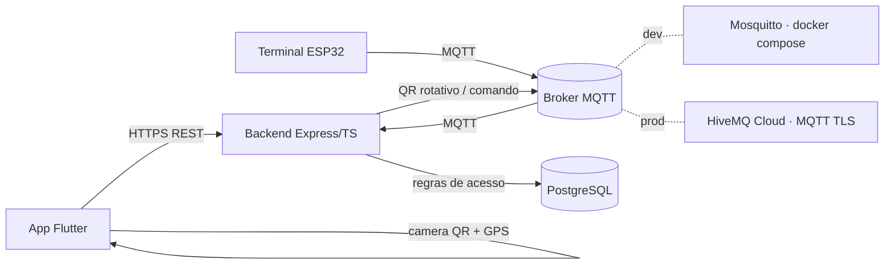

# Visão geral da arquitetura

O sistema controla o acesso de pessoas a um edifício em três frentes que conversam por rede: o **Terminal de Acesso** (ESP32) exibe um QR Code rotativo e lê tags NFC, publicando e recebendo comandos por MQTT; o **app móvel** (Flutter) autentica o usuário, escaneia o QR Code e envia a geolocalização; e o **backend** (Node + Express + TypeScript) concentra as regras de acesso, persiste os eventos em PostgreSQL e é a única fonte de decisão — o terminal nunca decide sozinho. Em desenvolvimento o broker é o Mosquitto do `infra/docker-compose.dev.yml` e o banco é o Postgres do mesmo compose; em produção a API roda no Vercel, o worker MQTT no Render, o banco no Neon e o broker é o HiveMQ Cloud com TLS (ver [`adr/001-provisionamento-vercel-neon.md`](adr/001-provisionamento-vercel-neon.md)).

## Diagrama

- **Dev**: broker Mosquitto local (porta `1884` no host, `1883` interna do container; sem TLS) e Postgres do compose — ver [`../guides/como-rodar.md`](../guides/como-rodar.md).
- **Prod**: HiveMQ Cloud (MQTT sobre TLS, com credenciais), Postgres no Neon, API no Vercel e worker MQTT no Render.

## Fluxo de acesso via QR

> **Pendência de decisão (US-04):** o ADR 001 define QR/NFC/heartbeat por HTTP e MQTT apenas para comandos, mas o passo 1 abaixo ainda descreve o QR via MQTT. O contrato da US-04 fecha a matriz por mensagem e atualiza este fluxo.

1. O backend publica um QR Code rotativo (validade de 10 s) no tópico MQTT do terminal.
2. O terminal exibe o QR Code no display.
3. O usuário escaneia o QR Code com o app.
4. O app envia o token lido do QR (com o identificador do terminal), a credencial do usuário e a geolocalização à API (HTTPS REST).
5. A API valida o token do QR (formato, terminal e expiração de 10 s), a credencial do usuário, a janela de uso, o número de usos, o local e a distância (≤ 100 m).
6. A API publica o comando de abertura no tópico do terminal e registra o evento de acesso.
7. O terminal abre a porta, sinaliza o resultado (LED/buzzer) e confirma a execução ao backend.

## Fluxo de acesso via NFC

1. O terminal lê a tag NFC e publica o UID no tópico MQTT.
2. A API recebe o UID e valida a credencial, a janela de uso, o número de usos, o local e a distância quando aplicável.
3. A API responde no tópico de comando do terminal — libera ou nega — e registra o evento de acesso.
4. O terminal abre a porta, sinaliza o resultado (LED/buzzer) e confirma a execução ao backend.

## Contrato MQTT

Tópicos, QoS, payloads e heartbeat/LWT ficam em [`contratos-mqtt.md`](contratos-mqtt.md) — documento criado na Sprint 1 pelo card **US-04** (MQTT v1 + simulador). Os nomes de tópicos citados nesta página são placeholders até esse contrato existir.
