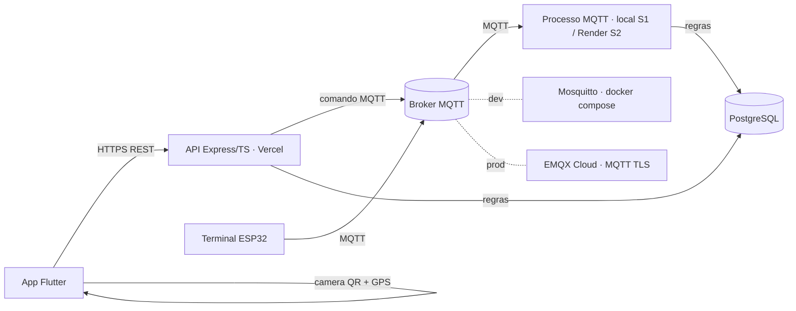

# Visão geral da arquitetura

O sistema controla o acesso de pessoas a um edifício em três frentes que conversam por rede: o **Terminal de Acesso** (ESP32) exibe um QR Code rotativo e lê tags NFC, publicando e recebendo comandos por MQTT; o **app móvel** (Flutter) autentica o usuário, escaneia o QR Code e envia a geolocalização; e o **backend** (Node + Express + TypeScript) concentra as regras de acesso, persiste os eventos em PostgreSQL e é a única fonte de decisão — o terminal nunca decide sozinho. Em desenvolvimento o broker é o Mosquitto do `infra/docker-compose.dev.yml` e o banco é o Postgres do mesmo compose; em produção a API roda no Vercel, o worker MQTT no Render, o banco no Neon e o broker é o EMQX Cloud Serverless com TLS (ver [`adr/001-provisionamento-vercel-neon.md`](adr/001-provisionamento-vercel-neon.md)).

Esse é o **desenho alvo**, não a declaração de que todo o fluxo está operacional. Em **02/11/2026**, NFC/GPS do firmware eram esqueletos; o terminal não publicava heartbeat/status e usava MQTT sem TLS; o app lia QR/posição mas não solicitava acesso ao backend (US-29). A decisão NFC no backend existia e era exercitada por terminal simulado; o worker Render não tinha deploy comprovado. Conferência histórica em [`../entrega/auditoria-estado-atual.md`](../entrega/auditoria-estado-atual.md).

**Atualização de 11/11/2026:** o app envia o pedido de acesso e tem as 12 telas do Figma; o NFC RC522 foi integrado (US-23) com evidência física inicial; o worker no Render foi observado no ar com `mqtt conectado` no EMQX TLS; a API está em `a0625d7`. Continuam pendentes o servo/cancela física, o GPS/heartbeat (US-24), a resiliência offline (US-25) e o fluxo completo app → terminal real.

**Atualização de 24/11/2026:** os diagramas finais de casos de uso, componentes, implantação e sequências QR/NFC estão na seção [Diagramas de arquitetura](#diagramas-de-arquitetura) (US-35), conferidos contra a `main` em `349575d`. Entrou também o acesso por NFC do celular (HCE, #77): o app gera uma prova de 60 s e de uso único na API e a apresenta ao leitor; o firmware lê a prova por ISO-DEP desde o #79. O heartbeat do terminal (US-24) foi implementado com status retained e LWT. O GPS do terminal ficou fora do escopo: o módulo NEO-6M não está disponível e a posição continua vindo do app.

## Diagrama

O modelo relacional persistido pelo backend está em [`modelo-dados.md`](modelo-dados.md).

### Diagramas de arquitetura

Todos em Mermaid, versionados neste diretório e conferidos contra o código da `main` em 23/11/2026 (US-35):

| Documento | Diagramas |
|---|---|
| [`casos-de-uso.md`](casos-de-uso.md) | Casos de uso com administrador, condômino, visitante e terminal, e a rota ou tópico de cada um |
| [`componentes-implantacao.md`](componentes-implantacao.md) | Componentes (app, API, worker, broker, banco, terminal) e implantação em dev e em produção |
| [`sequencias.md`](sequencias.md) | Sequências da rotação do QR, do acesso por QR, do acesso por NFC (tag e celular) e da entrega do comando, com frescor de 30 s, dedup, outbox/relay e ACK |
| [`modelo-dados.md`](modelo-dados.md) | Modelo relacional |
| [`contratos-mqtt.md`](contratos-mqtt.md) | Tópicos, payloads, QoS e LWT |
| [`caso-de-uso-modelo.md`](caso-de-uso-modelo.md) | Camadas do backend e a regra de dependência |

**Transporte**: app ↔ API por **HTTPS REST**; terminal ↔ backend por **MQTT bidirecional**. Na S1 o processo MQTT do backend roda localmente (US-04); na S2 o mesmo processo foi preparado para o Render (US-37, PR #26) e, em 11/11, o serviço foi observado **LIVE** com `mqtt conectado` no EMQX TLS 8883 e `/healthz` ok ([`us-37.md`](../entrega/evidencias/us-37.md)). A Vercel hospeda só a API.

**O que está mergeado ≠ o que foi observado** — retrato de 02/11/2026, mantido como histórico:

- **API na Vercel**: `/health` público respondeu `version: 6b6aa26`, `database: ok` às 19:02:27 UTC, após uma primeira resposta 503. O HEAD local auditado era `66fe44a`; não era a versão publicada. A resposta comprova conectividade naquele instante, não disponibilidade contínua.
- **Worker no Render**: código (`backend/src/main/worker.ts`) e `render.yaml` estavam na `main`, mas **o deploy efetivo não foi observado** em 02/11.
- **Relay da outbox**: roda só entre **18:45 e 23:05** em `America/Sao_Paulo` (DT-21, PR #45); fora da janela o polling não consulta o banco.

Em **11/11/2026**, a API respondeu `version: a0625d7` com `database: ok` e o worker foi observado LIVE no Render ([`us-37.md`](../entrega/evidencias/us-37.md)); continuidade e número de réplicas não foram medidos.

**Ambientes**:

- **Dev**: broker Mosquitto local (porta `1884` no host, `1883` interna do container; sem TLS) e Postgres do compose — ver [`../guides/como-rodar.md`](../guides/como-rodar.md).
- **Prod**: EMQX Cloud Serverless (MQTT sobre TLS, com credenciais; substituiu o HiveMQ Cloud, encerrado), Postgres no Neon, API no Vercel e processo MQTT no Render. O serviço do Render foi observado LIVE em 11/11, com `mqtt conectado` e `/healthz` ok ([`us-37.md`](../entrega/evidencias/us-37.md)); continuidade não medida. O terminal ESP32 fala TLS com o broker quando compilado com `MQTT_USE_TLS 1` (DT-06); conexão e negativos de certificado foram observados no ESP32 em 06/11/2026, mas o servo físico continua não implementado. A reconexão só inicia com a porta em `idle` ([`evidencias/dt-06.md`](../entrega/evidencias/dt-06.md)).

## Fluxo de acesso via QR

Fluxo alvo: o app já envia o pedido e mostra o resultado (US-29), e a leitura com câmera foi observada em aparelho em 11/11. O worker só publica QR para terminais vistos online, mas o firmware não envia esse status (US-24); a simulação precisa declarar o status sintético. A entrega no display do terminal e a abertura física da cancela continuam não demonstradas de ponta a ponta.

1. O processo MQTT do backend publica um QR Code rotativo (validade de 25 s) no tópico do terminal.
2. O terminal exibe o QR Code no display.
3. O usuário escaneia o QR Code com o app.
4. O app envia o token lido do QR (com o identificador do terminal), a credencial do usuário e a geolocalização à API (HTTPS REST).
5. A API valida o token do QR (formato, terminal e expiração de 25 s), a credencial do usuário, o intervalo contínuo de validade, o número de usos, o local e a distância. A DT-23 impõe `min(location.radiusMeters, 100)`, preservando raios menores; o banco restringe novos cadastros/edições a 1–100 m. Raios não finitos ou não positivos negam o QR. A correção foi implantada em produção em 10/11 (#56).
6. O caso de uso grava a decisão e o consumo da autorização na mesma transação, persiste o comando no registro compartilhado e publica a abertura no tópico do terminal (pela API na requisição do app; pelo processo MQTT nos fluxos do terminal).
7. O terminal abre a porta, sinaliza o resultado (LED/buzzer) e publica o ACK de execução.
8. O worker correlaciona o ACK no mesmo PostgreSQL usado pela API, mesmo após reinício. A decisão `GRANTED` é autorização; confirmação física depende do status do ACK.

## Fluxo de acesso via NFC

O backend implementa este processamento para mensagens simuladas e reais; a leitura RC522 pelo ESP32 foi integrada na US-23 (#67), com evidência física inicial e servo desabilitado nesse perfil. NFC não exige GPS do celular: a geofence é aplicada ao método QR.

1. O terminal lê a tag NFC e publica o UID no tópico MQTT de eventos.
2. O processo MQTT do backend recebe o UID e chama o caso de uso, que valida a credencial, a janela de uso, o número de usos, o local e a distância quando aplicável.
3. O processo MQTT responde no tópico de comando do terminal — libera ou nega — e registra o evento de acesso.
4. O terminal abre a porta, sinaliza o resultado (LED/buzzer) e publica o ACK de execução.

**NFC do celular (HCE, #77):** em vez do UID da tag, o celular entrega uma prova de 128 bits que o app pede em `POST /api/v1/access-credentials/nfc`. A prova vale 60 s, só o hash vai ao banco e ela é consumida no primeiro acesso aceito. O terminal lê a prova por ISO-DEP e a publica como `nfc_hce_read` (#79). Sequência completa em [`sequencias.md`](sequencias.md#3-acesso-por-nfc-tag-física-ou-celular).

## Matriz de transporte

| Mensagem | Transporte | Produtor → consumidor | Onde roda a regra |
|---|---|---|---|
| QR rotativo | MQTT `terminals/{id}/qr` | processo MQTT → terminal | backend gera token e expiração; terminal só exibe |
| Leitura NFC / tentativa | MQTT `terminals/{id}/access-events` (`type=nfc_read` ou `nfc_hce_read`) | terminal → processo MQTT | caso de uso valida credencial/autorização |
| Prova NFC do celular | HTTPS REST `POST /api/v1/access-credentials/nfc` | app → API | API emite a prova de 60 s e guarda só o hash |
| Heartbeat | MQTT `terminals/{id}/status` | terminal → processo MQTT | backend interpreta disponibilidade; LWT marca desconexão |
| Comando | MQTT `terminals/{id}/commands` | API ou processo MQTT → terminal | caso de uso decide; terminal executa comando válido |
| ACK de execução | MQTT `terminals/{id}/acks` | terminal → processo MQTT | backend correlaciona `commandId`; ACK não concede acesso |
| Pedido de acesso QR | HTTPS REST | app → API | API valida token, usuário, autorização e geolocalização |
| Evento de acesso | PostgreSQL | caso de uso → banco | backend registra tentativa e resultado |

Contrato mínimo: `messageId`, `terminalId`, versão e timestamp; comandos também com `commandId` e `expiresAt`. Comandos sem retenção e QoS 1; o consumidor deduplica e rejeita comando expirado. O detalhamento (payloads, QoS e LWT) fica em [`contratos-mqtt.md`](contratos-mqtt.md).

## Proteções DT-01/02/03

- O padrão é `ACCESS_MODE=real`: decisor real e tabelas validados antes de conectar ao MQTT. `demo` precisa ser explícito e é proibido em produção.
- `Terminal` resolve o local usado por NFC, QR e geofence. Terminal desconhecido ou desativado não abre acesso. A tentativa desconhecida é persistida com o identificador recebido e local nulo, consultável pelo histórico.
- `TerminalCommand` é o registro compartilhado por API e worker. A intenção de comando entra na mesma transação do evento e do consumo, com prazo ancorado na decisão; o ACK atualiza atomicamente por comando e terminal. Retentativa mantém identificador e prazo originais.
- O QR é o token assinado da US-19 (`v1.<terminal>.<iat>.<ttl>.<hmac>`, validade de 25 s), validado pelo `ValidateQrCredentialUseCase`; o usuário do pedido vem do JWT do login.
- Validação reproduzível sem Docker/admin em `backend`: `npm run test:e2e`. Roteiro em [`dt-01-02-03.md`](../entrega/evidencias/dt-01-02-03.md).
