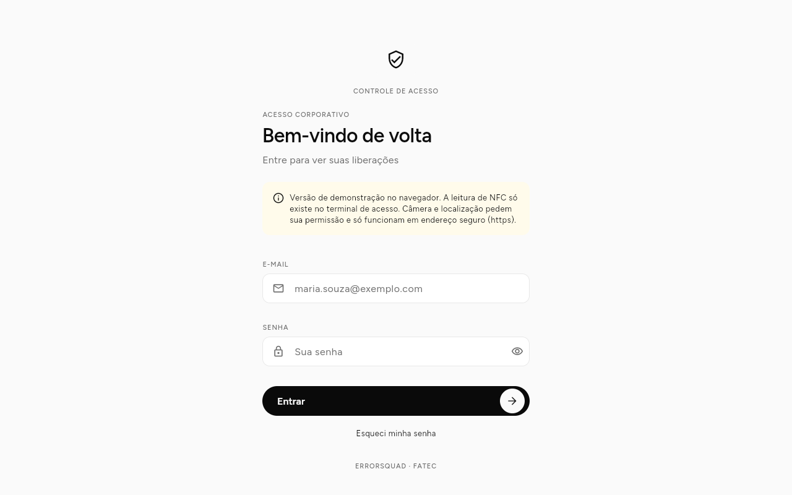
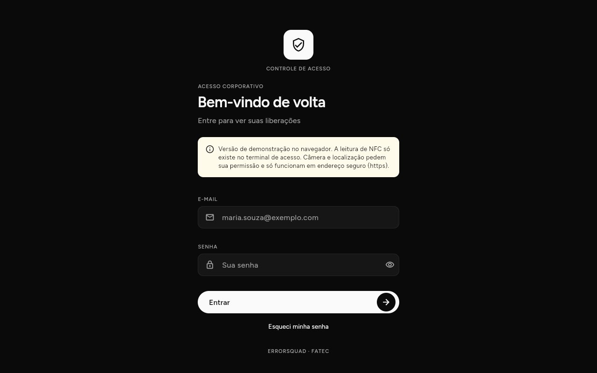

# US-38 — demo web e identidade de distribuição

Épico E6 · sprint alvo S3. Base: `main` em `0fb1292` (23/11/2026). Antes, os ícones da web (`favicon.png`, `Icon-*.png`) e do launcher Android (`mipmap-*/ic_launcher.png`) eram os padrão do Flutter, sem ícone adaptativo, e não havia demo web publicada.

## O que mudou

| Item | Antes | Depois |
|---|---|---|
| Fonte visual | — | [`design/identidade/marca.svg`](../../../design/identidade/marca.svg): escudo com check da tela Entrar do Figma, traço do design system; [gerador](../../../design/identidade/gerar_icones.py) e [prévia](../../../design/identidade/previa.png) versionados |
| Web | favicon 16 px e 4 ícones do Flutter | favicon 32 px e `Icon-192/512` normal e *maskable* gerados da marca; `theme-color` `#0A0A0A` no `index.html` |
| Android | 5 PNGs do Flutter | 5 PNGs `mipmap-*` gerados da marca (Android 7 e anteriores) e ícone adaptativo em vetor com fundo `#0A0A0A` e camada monocromática (`mipmap-anydpi-v26`) |
| Nome público | "Controle de Acesso" no manifest, Android e título | mantido; o `cd-web.yml` falha se o `<title>` ou o `manifest.name` mudarem |
| Limitações do navegador | — | aviso na tela Entrar, só na web: NFC só no terminal; câmera e localização só em HTTPS e com permissão (`WebDemoNotice`) |
| Layout no desktop | formulário esticado na largura da janela | conteúdo centralizado com 480 px no máximo (`WebFrame`); no Android nada muda |
| Publicação | — | `cd-web.yml`: build com `--dart-define=API_BASE_URL` em PR; na `main`, deploy num projeto próprio da Vercel e smoke test da página e do CORS |

## O que foi verificado

Em 23/11/2026, no Windows, com Flutter 3.47.3 (o CI usa 3.47.7):

- `flutter analyze` sem problemas; `flutter test` com **656 testes aprovados**, incluindo os 5 novos:
  - aviso na web nos dois temas, com tom de atenção e semântica;
  - nenhum aviso fora da web;
  - moldura de 480 px centralizada no navegador largo;
  - largura total no navegador estreito;
  - nenhuma mudança fora da web.
- `flutter build web --release --dart-define=API_BASE_URL=https://abp-4-sistema-controle-acesso.vercel.app` concluído; o build traz o favicon, os quatro ícones e o manifest com "Controle de Acesso".
- Build servido localmente e capturado no Chrome headless (1280×800) nos dois temas, com a marca, o aviso de limitações e a moldura de celular:

| Tema claro | Tema escuro |
|---|---|
|  |  |

- Ícones conferidos na [prévia](../../../design/identidade/previa.png): legíveis de 512 a 16 px e, no *maskable*, marca dentro da zona segura de 80% nas máscaras de círculo, squircle e quadrado arredondado.
- O `vercel deploy --prebuilt` da CLI 64.5.0 aceita a saída montada pelo workflow: sem `builds.json`, a CLI segue o deploy (conferido no código da CLI).

## Checklist no navegador

| Função | Situação |
|---|---|
| Página, título e ícones | verificado no build local |
| Aviso de limitações (NFC, HTTPS, permissões) | verificado no build local |
| Login, minhas autorizações e leitura de QR contra a API | **pendente**: depende da demo publicada e da origem dela no `CORS_ALLOWED_ORIGINS` da API; a API de produção não libera `localhost` |
| Câmera e localização com permissão | **pendente**: exigem HTTPS, ou seja, a demo publicada |
| NFC | não se aplica no navegador; declarado na tela |

## O que não foi verificado

- **Demo publicada:**
  - falta criar o projeto na Vercel e configurar `VERCEL_WEB_PROJECT_ID` e `WEB_URL` no GitHub;
  - falta incluir a origem da demo no CORS da API ([guia](../../guides/deploy.md#demo-web-us-38));
  - sem isso, o `cd-web-deploy` da `main` falha na validação da configuração;
  - ainda não há URL pública.
- **Web instalada (PWA):** o manifest e os ícones estão no build, mas a instalação e o ícone na área de trabalho ou na tela inicial não foram conferidos num navegador real.
- **APK release:** não há Android SDK nesta máquina. O `ci-mobile-build-android` gera o APK com os novos recursos; falta conferir o artefato e o launcher num aparelho, inclusive o ícone temático do Android 13+.
- As capturas são do build local, não da URL publicada.

## Como reproduzir

```bash
python -m pip install -r design/identidade/requirements.txt
python design/identidade/gerar_icones.py          # regenera ícones e prévia
cd mobile
flutter analyze && flutter test
flutter build web --release --dart-define=API_BASE_URL=https://abp-4-sistema-controle-acesso.vercel.app
cd build/web && python -m http.server 5055        # abrir http://127.0.0.1:5055
```
