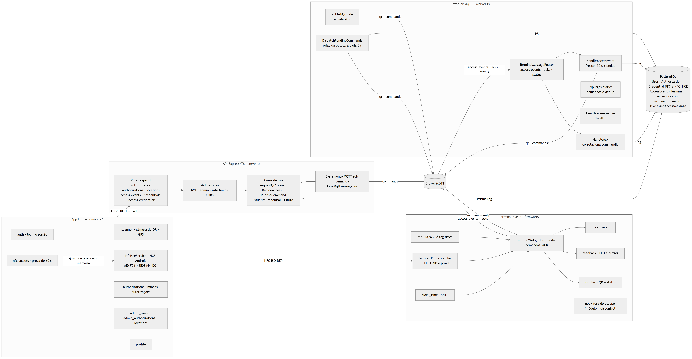
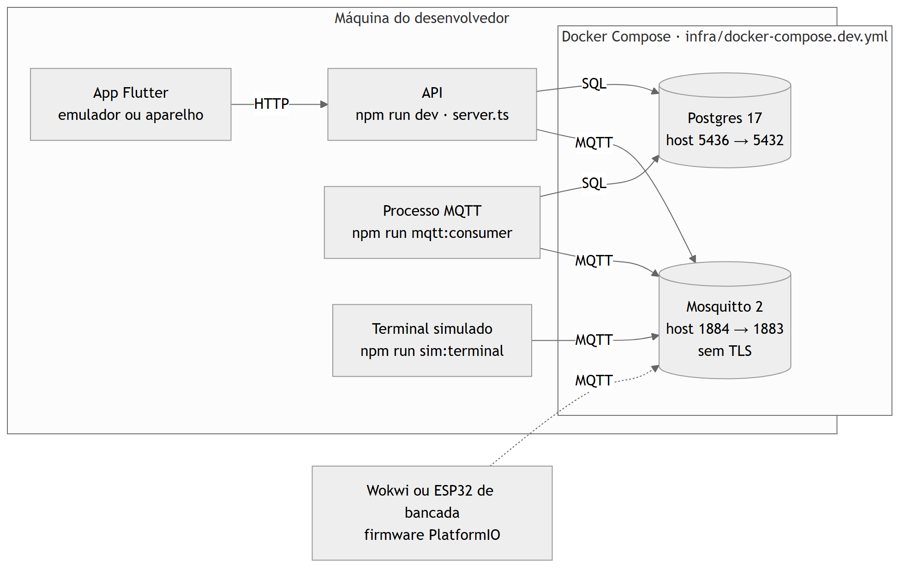
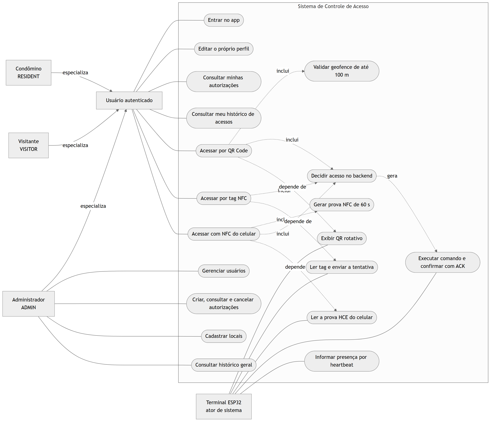
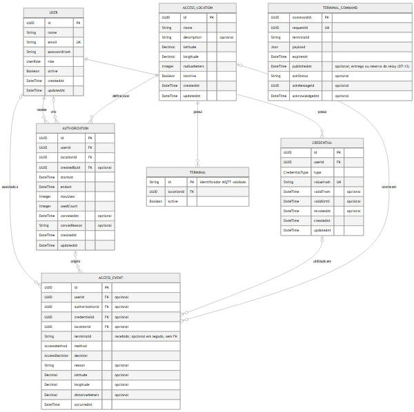
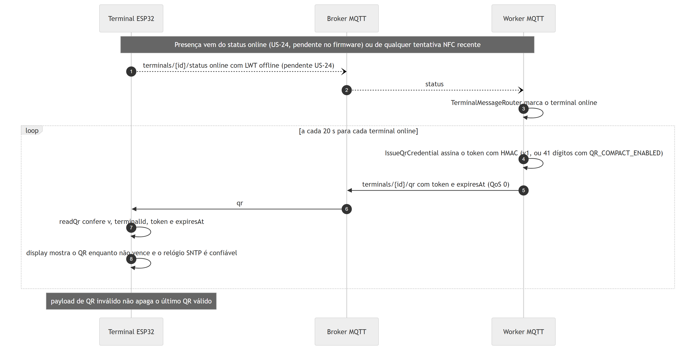
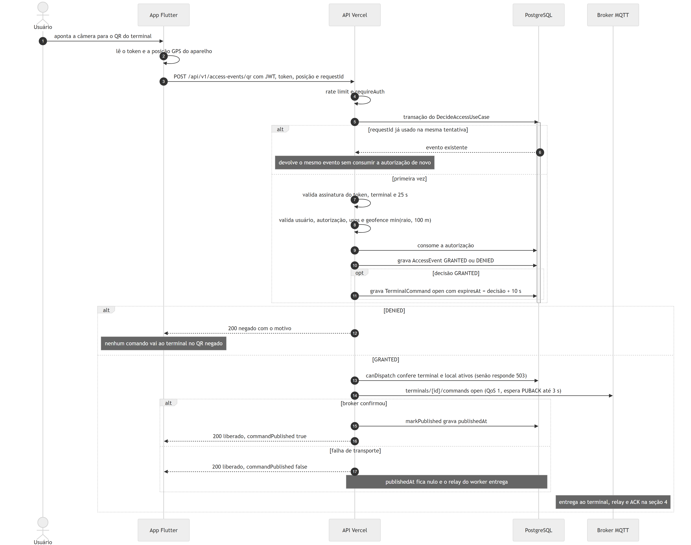
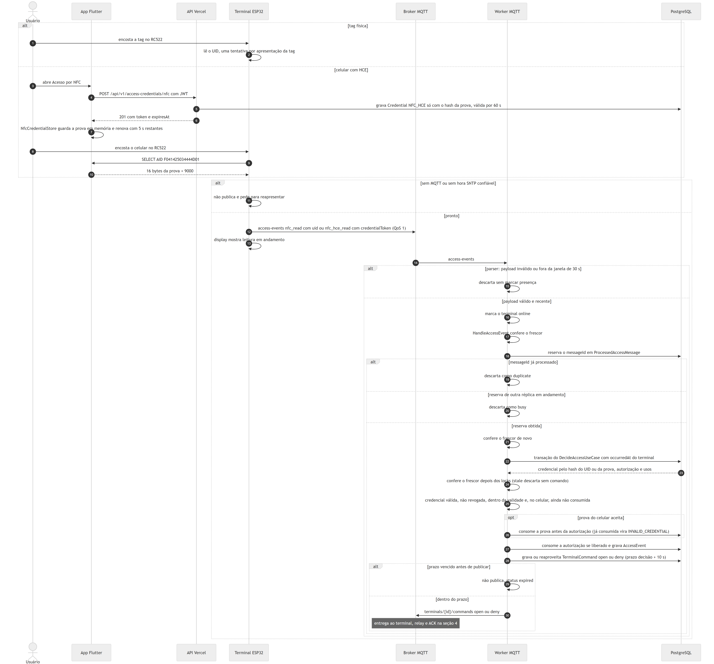
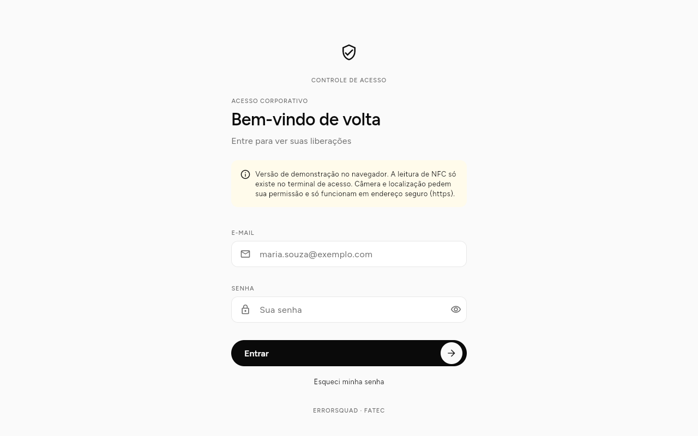
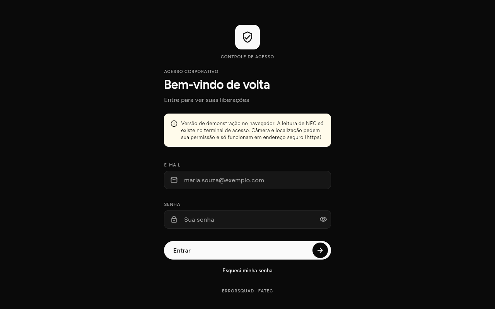

**CENTRO ESTADUAL DE EDUCAÇÃO TECNOLÓGICA PAULA SOUZA**  
**FACULDADE DE TECNOLOGIA DE JACAREÍ**  
**CURSO SUPERIOR DE TECNOLOGIA EM DESENVOLVIMENTO DE SOFTWARE MULTIPLATAFORMA**

    

**ERRORSQUAD**

   

**SISTEMA INTEGRADO DE CONTROLE DE ACESSO COM TERMINAL ESP32, APLICAÇÃO MÓVEL E BACKEND EM NUVEM**

    

**Arthur Facchinetti**  
**Caio Araujo**  
**Carlos Santo**  
**Felipe Pacheco**  
**João Victor Lopes Rosa**  
**Leo Silva**

    

**JACAREÍ**  
**2026**

**ERRORSQUAD**

   

**SISTEMA INTEGRADO DE CONTROLE DE ACESSO COM TERMINAL ESP32, APLICAÇÃO MÓVEL E BACKEND EM NUVEM**

    

Relatório técnico-científico apresentado à Faculdade de Tecnologia de Jacareí — FATEC Jacareí, como requisito parcial da Aprendizagem Baseada em Projetos (ABP) do curso Superior de Tecnologia em Desenvolvimento de Software Multiplataforma, referente ao Desafio 4DSM 2026-2.

Orientação: professor responsável pela disciplina de Projeto.

    

**JACAREÍ**  
**2026**

# RESUMO

Este trabalho descreve o desenvolvimento de um sistema integrado de controle de acesso para edifícios, composto por um terminal físico baseado em ESP32, uma aplicação móvel em Flutter e um backend em Node.js/TypeScript executado em nuvem. O problema tratado é a substituição de controles de acesso baseados em chaves ou credenciais estáticas por um fluxo auditável, com autorizações temporárias, QR Code rotativo e autenticação por NFC. A solução foi construída em três sprints, com arquitetura cliente-servidor, banco PostgreSQL, mensageria MQTT e implantação contínua. Os resultados incluem o fluxo de acesso por QR e por NFC validado com hardware real, o aplicativo com as telas de usuário e administração, a demo web publicada, o worker MQTT em operação e uma suíte automatizada com centenas de testes. Também são declaradas as limitações: o módulo GPS do terminal não estava disponível; a resiliência offline do firmware foi planejada e postergada; a medição de consumo elétrico não foi realizada; a abertura física de uma cancela real não foi demonstrada; e a revisão de segurança permanece em revisão por pares. O trabalho conclui que o objetivo de um controle de acesso funcional, auditável e integrável foi alcançado no escopo de software e de bancada, com as lacunas físicas explicitamente registradas.

**Palavras-chave:** controle de acesso; ESP32; NFC; QR Code; Flutter; MQTT; arquitetura em nuvem.

# ABSTRACT

This work describes the development of an integrated building access control system composed of an ESP32-based physical terminal, a Flutter mobile application, and a Node.js/TypeScript backend running in the cloud. The problem addressed is the replacement of key-based or static-credential access control with an auditable flow based on temporary authorizations, rotating QR codes, and NFC authentication. The solution was built in three sprints using a client-server architecture, a PostgreSQL database, MQTT messaging, and continuous deployment. Results include a QR and NFC access flow validated with real hardware, the mobile application with user and administration screens, a published web demo, an operating MQTT worker, and an automated test suite with hundreds of tests. Limitations are also stated: the terminal GPS module was unavailable; firmware offline resilience was planned and postponed; electrical consumption was not measured; physical gate actuation was not demonstrated with a real gate; and the security review remains under peer review. The work concludes that the goal of a functional, auditable, and integrable access control was achieved within the software and bench scope, with physical gaps explicitly recorded.

**Keywords:** access control; ESP32; NFC; QR Code; Flutter; MQTT; cloud architecture.

# LISTA DE ILUSTRAÇÕES

**Figura 1** – Componentes da solução  
**Figura 2** – Implantação em desenvolvimento e produção  
**Figura 3** – Casos de uso  
**Figura 4** – Modelo de dados  
**Figura 5** – Rotação do QR Code  
**Figura 6** – Acesso por QR Code  
**Figura 7** – Acesso por NFC (tag física e celular)  
**Figura 8** – Demo web: tela de entrada no tema claro  
**Figura 9** – Demo web: tela de entrada no tema escuro

# LISTA DE QUADROS

**Quadro 1** – Requisitos funcionais e situação final  
**Quadro 2** – Requisitos não funcionais e restrições  
**Quadro 3** – Entregas por sprint  
**Quadro 4** – Evidências de teste e operação  
**Quadro 5** – Rastreabilidade entre requisito, evidência e lacuna  
**Quadro 6** – Riscos residuais e tratamento

# LISTA DE ABREVIATURAS E SIGLAS

**ABP** — Aprendizagem Baseada em Projetos  
**ACK** — confirmação de execução de comando  
**API** — Application Programming Interface  
**ATS** — Answer To Select  
**CI/CD** — Integração Contínua e Entrega Contínua  
**ESP32** — microcontrolador com Wi-Fi e Bluetooth  
**HCE** — Host Card Emulation  
**JWT** — JSON Web Token  
**MQTT** — protocolo de mensageria publish/subscribe  
**NFC** — Near Field Communication  
**QR** — Quick Response  
**RBAC** — Role-Based Access Control  
**RC522** — leitor NFC de 13,56 MHz  
**REST** — Representational State Transfer  
**TLS** — Transport Layer Security

# SUMÁRIO

<!-- TOC -->

# 1 INTRODUÇÃO

## 1.1 Contexto e problema

O controle de acesso em edifícios costuma depender de chaves físicas, cartões de proximidade ou porteiros. Esses mecanismos são difíceis de auditar, de revogar em tempo real e de operar com autorizações temporárias, como a visita de um prestador por algumas horas. O desafio proposto pela FATEC Jacareí para o 4DSM 2026-2 pede um sistema de baixo custo com dois componentes principais: um terminal de acesso, responsável por ler QR Code e NFC e acionar a liberação, e uma aplicação móvel, usada para consultar autorizações, ler o QR e administrar o sistema (FATEC, 2026).

O problema técnico central é conciliar três requisitos que puxam em direções diferentes: (i) a decisão de acesso precisa ser centralizada e auditável, para que o terminal não seja uma autoridade isolada; (ii) a leitura no terminal precisa ser rápida o suficiente para uma pessoa encostar o celular ou a tag e receber o retorno; e (iii) a operação precisa sobreviver a falhas de rede sem liberar acesso por conta própria. A solução adotada separa a decisão da atuação: o terminal apenas lê a credencial e publica a tentativa; o backend decide; o terminal executa o comando já decidido e devolve um ACK.

## 1.2 Objetivos

O objetivo geral foi construir um sistema integrado de controle de acesso, com terminal físico, aplicação móvel e backend em nuvem, capaz de autorizar e registrar acessos por QR Code e NFC. Os objetivos específicos foram:

- modelar usuários, locais, autorizações e eventos de acesso em banco relacional;
- emitir QR Code assinado e rotativo, com validade curta e vínculo ao terminal;
- ler QR pelo aplicativo e enviar a tentativa com posição geográfica;
- ler tag NFC e prova efêmera de celular (HCE) pelo terminal;
- decidir o acesso no backend, consumir a autorização de forma transacional e registrar o evento;
- entregar o comando ao terminal por MQTT, executar a atuação e registrar o ACK;
- operar com implantação contínua, testes automatizados e documentação de arquitetura;
- publicar uma demonstração web do aplicativo como entrega complementar.

## 1.3 Justificativa

A separação entre decisão e atuação reduz o risco de um terminal comprometido liberar acesso por conta própria. O uso de credenciais temporárias e de uso único permite revogar acessos sem trocar fechaduras. O QR rotativo de 25 segundos e a prova HCE de 60 segundos, consumida no primeiro acesso aceito, reduzem a janela de reutilização de uma credencial capturada. A auditabilidade é obtida porque toda tentativa vira um evento com decisão, motivo, autorização e comando associado.

Do ponto de vista acadêmico, o projeto integra conteúdos de engenharia de software, banco de dados, redes, sistemas embarcados, desenvolvimento móvel e DevOps em um artefato único, com evidências versionadas e limitações declaradas.

## 1.4 Organização do trabalho

A Seção 2 apresenta os requisitos e as decisões de escopo. A Seção 3 descreve a arquitetura e as tecnologias. A Seção 4 percorre o desenvolvimento por sprint. A Seção 5 consolida os resultados e as evidências. A Seção 6 discute dificuldades e limitações. A Seção 7 conclui. Os apêndices reúnem o roteiro de reprodução e o índice de evidências.

# 2 REQUISITOS E ESCOPO

## 2.1 Requisitos do desafio

Os requisitos foram lidos do documento do Desafio 4DSM 2026-2 e mantidos em uma matriz versionada, com status e evidência por item (ERRORSQUAD, 2026a). A matriz distingue quatro situações: atendido, parcial, não atendido e não comprovado. Um requisito só é marcado como atendido quando existe evidência no repositório ou execução registrada; caso contrário, a lacuna é declarada.

**Quadro 1 – Requisitos funcionais e situação final**

| ID | Requisito (resumo) | Situação | Evidência principal |
|---|---|---|---|
| RF01 | Cadastro de usuários com perfis | Atendido | CRUD e RBAC no backend |
| RF02 | Cadastro de local de acesso | Atendido | API e tela de locais |
| RF03 | Autorização com janela, usos e situação | Parcial | Intervalo contínuo; não há janela diária |
| RF04 | Consulta de autorizações com filtros | Atendido | Listagem paginada e filtros |
| RF05 | Cancelamento de autorização | Atendido | Cancelamento com motivo |
| RF06 | Histórico de acessos | Atendido | Eventos e tela de histórico |
| RF07 | Autenticação no app | Atendido | Login JWT e sessão persistida |
| RF08 | Usuário vê suas autorizações | Atendido | Tela e API `/me/authorizations` |
| RF09 | Leitura de QR pelo app | Atendido | Scanner envia pedido e mostra resultado |
| RF10 | Leitura de NFC pelo terminal | Atendido | RC522, MQTT e decisão no backend |
| RF11 | Terminal com tela, NFC, sinalização, GPS e abertura | Parcial | Sem GPS (módulo indisponível); abertura física de cancela não demonstrada |
| RF12 | QR rotativo de 25 s | Atendido | Emissão e publicação no worker |
| RF13 | Validação do QR (assinatura, prazo, local, usos) | Atendido | Política de acesso e geofence de 100 m |
| RF14 | Validação NFC pelo backend | Atendido | Tag física e prova HCE |
| RF15 | Liberação do acesso | Atendido | Comando `open` e servo posicional |
| RF16 | Negação com indicação visual/sonora | Atendido | LED, buzzer e display |
| RF17 | Registro de toda tentativa | Atendido | Evento por decisão, com motivo e ACK |

Fonte: adaptado de ERRORSQUAD (2026a).

**Quadro 2 – Requisitos não funcionais e restrições**

| ID | Requisito (resumo) | Situação | Observação |
|---|---|---|---|
| RNF01 | IoT + backend Node/TS + API REST + app | Atendido | Monorepo com firmware, backend e mobile |
| RNF02 | Autenticação, proteção e comunicação segura | Parcial | JWT, HTTPS, TLS no broker e no firmware; revisão de segurança em revisão por pares |
| RNF03 | Retry/persistência sob falha | Parcial | Outbox no backend; fila local do firmware postergada (US-25) |
| RNF04 | Interface acessível ao público idoso | Parcial | Fonte ampliada e rótulos; auditoria formal não realizada |
| RNF05 | Modularidade | Atendido | Clean Architecture e regra de camadas |
| RNF06 | Banco em nuvem | Atendido | PostgreSQL no Neon |
| RNF07 | Eficiência energética | Parcial | Projeto e orçamento documentados; consumo não medido |
| RNF08 | CI com build, testes e lint | Parcial | Checks obrigatórios; firmware sem lint dedicado |
| RNF09 | CD automatizado | Atendido | Deploy do backend após CI |
| RNF10 | Testes no pipeline | Atendido | Backend, mobile e firmware |
| RNF11 | Git com branches e commits descritivos | Atendido | Fluxo por branch e PR |
| RNF12 | Feedback de build/deploy | Atendido | GitHub Actions |
| RP01 | Node.js + Express + TypeScript | Atendido | Backend |
| RP02 | Integração com dispositivo físico | Parcial | NFC, display, servo e feedback; GPS ausente |
| RP03 | Protocolo IoT | Atendido | MQTT v1 |
| RP04 | Aplicativo móvel | Atendido | Flutter/Android |
| RP05 | Cliente-servidor | Atendido | App, API, worker e terminal |
| RP06 | Desenvolvimento incremental | Atendido | Três sprints |
| RP07 | Documentação de arquitetura | Atendido | Diagramas em Mermaid |
| RP08 | Escopo viável com simulações | Atendido | Wokwi e simulador Node |
| RP09 | Pipeline CI/CD | Atendido | GitHub Actions |
| RP10 | Testes no pipeline | Atendido | RNF10 |
| RP11 | Deploy automatizado em nuvem | Atendido | Vercel, Render e Neon |
| RP12 | Conteinerização | Parcial | Backend e infraestrutura local |

Fonte: adaptado de ERRORSQUAD (2026a).

## 2.2 Decisões de escopo

Três decisões foram tomadas e registradas ao longo do projeto. A primeira foi não usar o UID aleatório do celular como identidade: o Android apresenta um UID que muda a cada aproximação, e usá-lo criaria uma identidade instável e não autenticada. Em vez disso, o aplicativo emite uma prova efêmera de 128 bits na API e a apresenta por HCE; o banco guarda apenas o hash, e a prova é consumida no primeiro acesso aceito (ERRORSQUAD, 2026b).

A segunda foi manter o terminal sem autoridade de decisão. Sem rede ou sem hora confiável, o terminal recusa o comando; ele nunca abre a porta por conta própria. A terceira foi declarar o GPS do terminal fora do escopo quando o módulo NEO-6M não estava disponível. A posição usada na decisão continua vindo do aplicativo no pedido de QR, e o terminal não publica coordenada.

# 3 ARQUITETURA E TECNOLOGIAS

## 3.1 Visão geral

A solução é um monorepo com quatro partes: aplicativo Flutter, API REST em Node.js/TypeScript, worker MQTT e firmware ESP32. A API e o worker compartilham o mesmo código de domínio e o mesmo banco PostgreSQL, mas são processos separados: a API atende o aplicativo por HTTPS; o worker permanece conectado ao broker e processa tentativas, ACKs e presença. O terminal fala MQTT com o broker e nunca acessa o banco.

<figure>

<figcaption><strong>Figura 1</strong> – Componentes da solução Fonte: elaborado pelos autores (2026).</figcaption>
</figure>

A Figura 2 mostra a implantação. Em desenvolvimento, o banco e o broker sobem por Docker Compose e a API/worker rodam localmente. Em produção, a API está na Vercel, o worker no Render, o banco no Neon e o broker no EMQX Cloud com TLS. O aplicativo é distribuído como APK de depuração para a banca; a demo web é publicada em projeto separado na Vercel.

<figure>

<figcaption><strong>Figura 2</strong> – Implantação em desenvolvimento e produção Fonte: elaborado pelos autores (2026).</figcaption>
</figure>

<figure>

<figcaption><strong>Figura 3</strong> – Casos de uso Fonte: elaborado pelos autores (2026).</figcaption>
</figure>

A Figura 3 resume os atores e casos de uso. O usuário autenticado consulta autorizações, escaneia o QR e usa o NFC do celular; o administrador gerencia usuários, autorizações e locais; o terminal exibe o QR, lê tag e celular, executa o comando e confirma com ACK. O heartbeat de presença está implementado no firmware, mas ainda não foi confirmado no hardware.

## 3.2 Backend

O backend segue uma separação em camadas: `domain` concentra entidades e regras sem dependência externa; `application` orquestra casos de uso; `infrastructure` implementa Prisma, MQTT e HTTP; `main` monta a aplicação. A regra de dependência é verificada no lint. A API expõe contrato REST versionado e documentação OpenAPI; a validação de entrada usa Zod, e os erros de domínio são traduzidos para respostas HTTP sem vazar detalhes internos (ERRORSQUAD, 2026c).

Os fluxos principais são: emissão de QR assinado; emissão de prova HCE; decisão de acesso para QR, tag NFC e HCE; consulta de autorizações e histórico; e administração de usuários e locais. A decisão acontece em uma transação que grava o evento, consome a autorização e, quando liberado, grava o comando na outbox. O consumo condicional evita gastar um uso quando a autorização já se esgotou ou quando a credencial HCE já foi consumida.

## 3.3 Aplicativo móvel

O aplicativo foi desenvolvido em Flutter, com Riverpod para estado e `go_router` para navegação. As telas cobrem login, autorizações, detalhe, histórico, perfil, locais, administração e scanner. O scanner usa `mobile_scanner` para ler o QR e `geolocator` para obter a posição; o pedido é enviado com um `requestId` idempotente. A sessão é persistida no armazenamento seguro do aparelho, e o token é anexado apenas em requisições para a origem da API.

Um ajuste relevante ocorreu no fim da Sprint 3: a localização passou a ser buscada na abertura do aplicativo, e não apenas quando o QR é lido. Sem isso, o GPS a frio podia exceder o limite de dez segundos e o pedido nem chegava ao backend. O aplicativo reaproveita a posição apenas se ela for recente e precisa; caso contrário, busca uma nova dentro do mesmo limite.

## 3.4 Firmware do terminal

O firmware é escrito em C++ com PlatformIO para ESP32. Os módulos separam responsabilidades: `mqtt` (conexão, TLS, comandos, ACK, status), `nfc` (RC522 e HCE), `display` (OLED e LCD), `door` (servo posicional), `feedback` (LED e buzzer), `clock_time` (SNTP) e `gps` (esqueleto, sem módulo disponível). O terminal só executa um comando se tiver hora confiável, se o comando estiver dentro do prazo e se a porta não estiver em ciclo. O ACK é publicado uma vez; o relay do backend republica o mesmo comando enquanto não houver ACK, e o terminal deduplica por `commandId`.

## 3.5 Modelo de dados

O modelo relacional cobre usuários, locais, autorizações, credenciais, eventos, terminais, comandos e deduplicação de mensagens. A Figura 7 apresenta as entidades principais e seus relacionamentos. A credencial armazena somente o hash do token ou do UID normalizado; a prova HCE tem `consumedAt` para garantir uso único.

<figure>

<figcaption><strong>Figura 4</strong> – Modelo de dados Fonte: elaborado pelos autores (2026).</figcaption>
</figure>

## 3.6 Segurança e operação

A autenticação usa JWT com segredo obrigatório em produção, perfis ADMIN/RESIDENT/VISITOR e limitação de tentativas de login. A API responde por HTTPS e aplica CORS por allowlist exata; a demo web tem sua origem cadastrada explicitamente. O broker exige TLS, e o firmware valida o certificado com CA embutida — a configuração que aceita qualquer certificado é proibida no CI. Segredos de produção ficam no provedor e não são versionados. A revisão de segurança complementar foi conduzida e está em revisão por pares; os riscos residuais e os aceites formais pendentes estão registrados na evidência da US-33.

# 4 DESENVOLVIMENTO POR SPRINT

## 4.1 Sprint 1 — fundação

A Sprint 1 (15 a 21 de outubro de 2026) teve como objetivo colocar a fundação no ar e um esqueleto conversando ponta a ponta em simulação. Foram entregues a estrutura do monorepo, o esqueleto do backend com autenticação e usuários, o firmware inicial com display, servo, LED e buzzer, o simulador de terminal e a infraestrutura local com Mosquitto e PostgreSQL. A revisão e a retrospectiva registraram o que funcionou e o que precisava amadurecer: contrato, testes e deploy.

## 4.2 Sprint 2 — fluxo QR real

A Sprint 2 (22 de outubro a 11 de novembro) entregou o fluxo QR no backend, a credencial de 25 segundos, a decisão de acesso, o evento auditado, a outbox e o worker MQTT com relay e deduplicação. Também entraram o login real no aplicativo, as telas do Figma, a administração de usuários, autorizações e locais, e o endurecimento de entrega: migrations no CD, seed protegida, TLS no firmware, CORS, teto de 100 metros, Actions pinadas por SHA e Dependabot (ERRORSQUAD, 2026d).

O fechamento ocorreu em 10 de novembro, um dia antes da Review, com 11 de 13 histórias concluídas; as duas restantes e algumas antecipações da Sprint 3 foram concluídas em 11 de novembro. O documento da Review 2 registra a separação entre o que estava no servidor, o que estava no aplicativo e o que ainda dependia de bancada.

## 4.3 Sprint 3 — NFC, hardware e entrega

A Sprint 3 (12 a 25 de novembro) concentrou o que faltava para o controle de acesso físico e para a entrega final. As entregas efetivas foram:

- **NFC físico (US-23):** leitura de tag pelo RC522, publicação MQTT, decisão no backend e feedback no terminal.
- **HCE do celular (US-24 e PR #77):** prova efêmera emitida pela API e apresentada pelo `HostApduService`; o firmware lê a prova por ISO-DEP e publica `nfc_hce_read`.
- **QR compacto e display (US-22):** QR numérico de 41 dígitos renderizado no OLED, com margem e escala adequadas, e status no LCD.
- **Heartbeat e presença (US-24):** status retained a cada 30 segundos e LWT `offline`; o firmware passa a anunciar presença sem depender de uma leitura NFC.
- **Diagramas finais (US-35):** casos de uso, componentes, implantação e sequências em Mermaid, conferidos contra o código.
- **Demo web e identidade (US-38):** build web publicado na Vercel, ícones da marca e aviso de limitações do navegador.
- **Encerramento da dívida de energia (DT-22):** decisão, orçamento estimado e procedimento documentados; a medição não foi realizada e o requisito permanece parcial.
- **Relatório e apresentação (US-36):** este documento, a pasta de mídias e o roteiro de demonstração.

A US-25 (resiliência offline do firmware) foi analisada, teve o escopo detalhado e foi movida para bloqueio por decisão do time: ela não bloqueia a entrega e mexe no caminho de reconexão e na persistência local, com risco de instabilidade na véspera da banca. O card registra o escopo preservado para retomada.

**Quadro 3 – Entregas por sprint**

| Sprint | Período | Foco | Resultado principal |
|---|---|---|---|
| S1 | 15–21/10/2026 | Fundação | Monorepo, esqueletos, simulação e infraestrutura local |
| S2 | 22/10–11/11/2026 | Fluxo QR real | Decisão, evento, outbox, app, admin e deploy |
| S3 | 12–25/11/2026 | NFC, hardware e entrega | Tag, HCE, QR no OLED, heartbeat, demo web e documentação final |

Fonte: elaborado pelos autores (2026).

## 4.4 Processo e qualidade

O time trabalhou com branches por card, commits descritivos, pull requests e revisão por pares. A `main` exige seis checks obrigatórios e uma aprovação; o CodeQL complementa a análise. O Definition of Done inclui testes, documentação afetada e evidência. As evidências ficam em `docs/entrega/evidencias/`, uma por card, com o que foi verificado, o que não foi e como reproduzir.

# 5 RESULTADOS E EVIDÊNCIAS

## 5.1 Testes e integração contínua

Na data de entrega, a suíte do aplicativo tinha 664 testes aprovados e análise estática sem problemas. O backend teve 450 testes aprovados no merge do fluxo HCE, incluindo integração e unitários; a suíte de firmware tem testes host para lógica pura, MQTT com broker simulado, TLS, timing da porta e leitura NFC/HCE, além de builds com e sem TLS. O CI executa build do backend, Docker, análise e testes do app, build e instalação do APK, e build do firmware com `-Werror` nos testes host.

**Quadro 4 – Evidências de teste e operação**

| Item | Evidência |
|---|---|
| App Flutter | 664 testes aprovados; `flutter analyze` sem problemas (24/11/2026) |
| Backend | 450 testes aprovados no merge do #77; CI com lint, typecheck, testes, build e E2E |
| Firmware | Suite host (MQTT, TLS, NFC/HCE, display, servo, timing) e builds PlatformIO |
| CI | Seis checks obrigatórios + CodeQL + Dependabot |
| API em produção | `/health` com `status: ok` e `database: ok` |
| Worker MQTT | `/healthz` com `status: ok`; conexão TLS ao broker |
| Demo web | Página, manifest, rota de login e CORS verificados em 24/11/2026 |
| Hardware | QR, tag física e HCE com decisão `GRANTED` e ACK `executed` |

Fonte: elaborado pelos autores (2026).

## 5.2 Acesso por QR Code

A Figura 6 mostra a sequência do acesso por QR. O aplicativo lê o token exibido no terminal, obtém a posição e envia o pedido com um `requestId`. A API valida assinatura, prazo, terminal, credencial, autorização, usos e distância; grava o evento; consome a autorização; e publica o comando. O terminal executa e devolve o ACK. Em 23 e 24 de novembro, leituras reais produziram eventos `GRANTED` com ACK `executed`; tentativas fora do raio produziram `DENIED` com motivo `OUT_OF_RANGE`, sem comando.

<figure>

<figcaption><strong>Figura 5</strong> – Rotação do QR Code Fonte: elaborado pelos autores (2026).</figcaption>
</figure>

<figure>

<figcaption><strong>Figura 6</strong> – Acesso por QR Code Fonte: elaborado pelos autores (2026).</figcaption>
</figure>

## 5.3 Acesso por NFC: tag física e celular

A Figura 7 mostra as duas formas de NFC. A tag física envia o UID normalizado. O celular envia uma prova de 128 bits obtida na API, apresentada por HCE; o firmware envia o `SELECT AID`, recebe 16 bytes e o status `9000`, e publica `nfc_hce_read`. A prova é consumida no primeiro acesso aceito; uma segunda apresentação da mesma prova é negada com `INVALID_CREDENTIAL`, sem gastar um novo uso da autorização.

<figure>

<figcaption><strong>Figura 7</strong> – Acesso por NFC (tag física e celular) Fonte: elaborado pelos autores (2026).</figcaption>
</figure>

Em bancada, a tag física abriu o acesso duas vezes, e o NFC do celular abriu quatro vezes, todas com ACK `executed`. A leitura do celular exigiu um ajuste de tempo: o RC522 espera 25 milissegundos por resposta, e o Android levava mais que isso para conectar ao serviço HCE na primeira apresentação. A correção foi preparar o serviço enquanto o aplicativo está em primeiro plano na tela de NFC, sem mudar a autorização nem a prova.

## 5.4 Demo web

A demo web foi publicada em `https://abp4-demo-web.vercel.app`, em projeto separado da API. A tela de entrada, o manifest e a rota de login foram verificados, o console não apresentou erros e o navegador conseguiu ler a resposta de `/health` da API, o que confirma o CORS com a origem exata. A demo não oferece a ação de NFC do Android nem o controle de zoom do scanner, porque esses recursos dependem de plugin e de câmera que não existem no navegador.

<figure>

<figcaption><strong>Figura 8</strong> – Demo web: tela de entrada no tema claro Fonte: captura dos autores em 24/11/2026.</figcaption>
</figure>

<figure>

<figcaption><strong>Figura 9</strong> – Demo web: tela de entrada no tema escuro Fonte: captura dos autores em 24/11/2026.</figcaption>
</figure>

## 5.5 Presença e heartbeat

O firmware publica `terminals/{id}/status` retained, QoS 1, ao conectar e a cada 30 segundos, com `state: online` e a versão do firmware. Ao conectar, registra também o LWT `offline` retained. Com isso, o worker deixa de depender de uma leitura NFC recente para considerar o terminal online e voltar a publicar o QR após um boot. O código foi mergeado e tem teste host; a confirmação no ESP32 ficou pendente porque o firmware não foi regravado na véspera da entrega.

## 5.6 Implantação e operação

A API de produção respondeu com banco ok durante a entrega; a demo web está publicada; o worker MQTT está no ar com `/healthz` ok. O banco está no Neon, com migrations aplicadas. O broker está no EMQX Cloud com TLS. A operação contínua não foi medida além das verificações pontuais; a evidência da US-37 registra essa distinção.

## 5.7 Rastreabilidade

O Quadro 5 liga cada requisito crítico à evidência e à lacuna. A regra adotada é: o que não tem evidência não é apresentado como comprovado.

**Quadro 5 – Rastreabilidade entre requisito, evidência e lacuna**

| Requisito | Evidência | Lacuna declarada |
|---|---|---|
| RF09/RF13 (QR) | eventos e ACK no banco; captura do app | abertura física de cancela não demonstrada |
| RF10/RF14 (NFC) | tag e HCE com ACK; evidência US-23 | GPS do terminal ausente |
| RF11 | display, servo, LEDs, buzzer e heartbeat | módulo NEO-6M indisponível |
| RF17 | eventos com decisão, motivo e comando | — |
| RNF02 | TLS no firmware e no broker; revisão US-33 | aceites formais e auditoria de dependências pendentes |
| RNF03 | outbox e relay no backend | fila local do firmware (US-25) bloqueada |
| RNF07 | decisão e orçamento em `dt-22.md` | consumo não medido |
| RNF08 | CI com seis checks | firmware sem lint dedicado |

Fonte: elaborado pelos autores (2026).

# 6 DIFICULDADES E LIMITAÇÕES

## 6.1 Tempo de resposta do HCE no RC522

O leitor RC522 abandona a espera por resposta em cerca de 25 milissegundos. Na primeira apresentação do celular, o Android levava mais tempo para conectar o serviço de emulação, e o leitor registrava timeout. A análise dos logs do Android e do firmware mostrou que o serviço era encontrado, mas a conexão chegava tarde. A solução foi antecipar o serviço enquanto o aplicativo está em primeiro plano e reduzir a resposta para 16 bytes binários, o menor quadro que o leitor já havia demonstrado aceitar. O problema ilustra a diferença entre “o protocolo está correto” e “o protocolo cabe no tempo do hardware”.

## 6.2 GPS do aplicativo

A primeira versão pedia a posição apenas após a leitura do QR, com limite de dez segundos. Em ambiente interno, o GPS a frio podia exceder o limite e o pedido nem era enviado. A correção passou a iniciar a busca na abertura do aplicativo e a aproveitar uma posição recente e precisa; o limite de dez segundos foi mantido. A solução não inventa posição: se não houver leitura válida, o aplicativo informa a falha.

## 6.3 Módulo GPS do terminal

O terminal foi planejado com um módulo NEO-6M, mas o componente não estava disponível. Em vez de simular coordenadas — o que produziria uma evidência falsa ”, o GPS foi declarado fora do escopo. A posição continua vindo do aplicativo, e o terminal não publica coordenada. O requisito RF11 permanece parcial por esse motivo, e a matriz registra a lacuna.

## 6.4 Resiliência offline

A US-25 previa backoff com jitter e fila local persistida para sobreviver a quedas de rede. A análise mostrou que a mudança mexe no caminho de reconexão e no armazenamento não volátil do ESP32, com risco de instabilidade na véspera da banca. O card foi movido para bloqueio, com o escopo preservado: backoff com teto e jitter, fila com capacidade e TTL, carimbo de tempo na leitura, reenvio apenas dentro de 30 segundos, descarte contado e deduplicação por `messageId`.

## 6.5 Abertura física e energia

O servo posicional é acionado e o feedback funciona, mas o mecanismo físico de uma cancela ou catraca real não foi acoplado. O requisito de “liberação do acesso” está atendido no nível do comando e da atuação elétrica; a demonstração em uma porta real não foi feita. A medição de consumo elétrico também não foi realizada: a DT-22 foi encerrada com decisão de projeto, orçamento estimado em faixa e procedimento de medição preservado, sem declarar valores medidos.

## 6.6 Segurança e aceites pendentes

A revisão de segurança encontrou riscos que dependem de decisão do time, como o rate limit em memória não agregar réplicas e o JWT não ter revogação no servidor. Esses riscos estão documentados com recomendação e responsável pendente; não foram apresentados como aceitos. A auditoria automatizada de dependências e a validação de headers no ambiente hospedado também ficaram pendentes. O relatório não trata esses pontos como resolvidos.

**Quadro 6 – Riscos residuais e tratamento**

| Risco | Tratamento atual |
|---|---|
| Perda de credencial HCE | prova de uso único, hash no banco e expiração de 60 s |
| Reutilização de QR | validade de 25 s, vínculo ao terminal e idempotência |
| Queda de rede no terminal | comando não é executado sem hora confiável; fila offline postergada |
| Terminal comprometido | terminal não decide acesso; só executa comando assinado pela decisão |
| worker reiniciar e perder presença | heartbeat/LWT implementado; confirmação no hardware pendente |
| Consumo elétrico desconhecido | orçamento e procedimento documentados; medição não realizada |

Fonte: elaborado pelos autores (2026).

# 7 CONCLUSÃO

O projeto entregou um sistema de controle de acesso funcional no escopo de software e de bancada. O aplicativo lê o QR, envia a posição e mostra a decisão; o terminal lê tag e celular, executa o comando e confirma; o backend decide, audita e entrega o comando; o worker mantém a mensageria; e a infraestrutura opera em nuvem com testes e implantação contínua. O fluxo foi exercitado com hardware real: QR, tag física e HCE produziram eventos e ACKs registrados.

As limitações estão declaradas e não escondidas: o GPS do terminal não existe no protótipo, a fila offline do firmware foi postergada, o consumo elétrico não foi medido, a abertura de uma cancela real não foi demonstrada e a revisão de segurança ainda tem aceites pendentes. O trabalho mostra que a separação entre decisão e atuação, a credencial temporária e o registro de cada tentativa são viáveis em um protótipo de baixo custo, e deixa um caminho claro para fechar as lacunas físicas.

Como trabalhos futuros, destacam-se: concluir a US-25 com fila persistida e backoff; integrar o módulo GPS quando disponível ou substituí-lo por uma fonte de posição documentada; acoplar o servo a uma cancela real e medir o consumo; concluir a auditoria de segurança e os aceites formais; e evoluir a demo web para cobrir login e leitura de QR com uma conta de demonstração.

# REFERÊNCIAS

ASSOCIAÇÃO BRASILEIRA DE NORMAS TÉCNICAS. **NBR 14724**: informação e documentação — trabalhos acadêmicos — apresentação. Rio de Janeiro: ABNT, 2011.

ASSOCIAÇÃO BRASILEIRA DE NORMAS TÉCNICAS. **NBR 6023**: informação e documentação — referências — elaboração. Rio de Janeiro: ABNT, 2018.

ASSOCIAÇÃO BRASILEIRA DE NORMAS TÉCNICAS. **NBR 10520**: informação e documentação — citações em documentos — apresentação. Rio de Janeiro: ABNT, 2023.

ASSOCIAÇÃO BRASILEIRA DE NORMAS TÉCNICAS. **NBR 6027**: informação e documentação — sumário — apresentação. Rio de Janeiro: ABNT, 2012.

ASSOCIAÇÃO BRASILEIRA DE NORMAS TÉCNICAS. **NBR 6028**: informação e documentação — resumo, resenha e recensão — apresentação. Rio de Janeiro: ABNT, 2021.

ERRORSQUAD. **ABP4 — Sistema de Controle de Acesso**: repositório do projeto. 2026a. Disponível em: https://github.com/ErrorSquad-ABP/ABP4-Sistema-Controle-Acesso. Acesso em: 24 nov. 2026.

ERRORSQUAD. **Contratos MQTT v1**. 2026b. Disponível em: https://github.com/ErrorSquad-ABP/ABP4-Sistema-Controle-Acesso/blob/main/docs/architecture/contratos-mqtt.md. Acesso em: 24 nov. 2026.

ERRORSQUAD. **Documentação da API**. 2026c. Disponível em: https://github.com/ErrorSquad-ABP/ABP4-Sistema-Controle-Acesso/blob/main/docs/api/README.md. Acesso em: 24 nov. 2026.

ERRORSQUAD. **Review 2 — Sprint 2**. 2026d. Disponível em: https://github.com/ErrorSquad-ABP/ABP4-Sistema-Controle-Acesso/blob/main/docs/entrega/review-2.md. Acesso em: 24 nov. 2026.

ERRORSQUAD. **Matriz de requisitos**. 2026e. Disponível em: https://github.com/ErrorSquad-ABP/ABP4-Sistema-Controle-Acesso/blob/main/docs/entrega/matriz-requisitos.md. Acesso em: 24 nov. 2026.

ESPRESSIF SYSTEMS. **ESP32 Series Datasheet**. 2024. Disponível em: https://www.espressif.com/sites/default/files/documentation/esp32_datasheet_en.pdf. Acesso em: 24 nov. 2026.

FACULDADE DE TECNOLOGIA DE JACAREÍ. **Desafio 4DSM 2026-2**. Jacareí: FATEC, 2026. Documento do desafio.

GOOGLE. **Flutter documentation**. 2026. Disponível em: https://docs.flutter.dev. Acesso em: 24 nov. 2026.

GOOGLE. **Host-based card emulation overview**. 2026. Disponível em: https://developer.android.com/develop/connectivity/nfc/hce. Acesso em: 24 nov. 2026.

INTERNATIONAL ORGANIZATION FOR STANDARDIZATION. **ISO/IEC 14443-4**: cards and security devices for personal identification — contactless proximity objects — Part 4: transmission protocol. Geneva: ISO, 2018.

OASIS. **MQTT Version 3.1.1**: OASIS Standard. 2014. Disponível em: https://docs.oasis-open.org/mqtt/mqtt/v3.1.1/os/mqtt-v3.1.1-os.html. Acesso em: 24 nov. 2026.

PRISMA. **Prisma ORM documentation**. 2026. Disponível em: https://www.prisma.io/docs. Acesso em: 24 nov. 2026.

# APÊNDICE A — ROTEIRO DE REPRODUÇÃO

1. Clonar o repositório e instalar as dependências do backend, do aplicativo e do firmware conforme os guias em `docs/guides/`.
2. Subir a infraestrutura local com Docker Compose (Mosquitto e PostgreSQL).
3. Rodar as migrations e a seed de demonstração no banco local.
4. Iniciar a API e o worker; conferir `/health` e `/healthz`.
5. Abrir o aplicativo no emulador ou aparelho, autenticar e verificar a lista de autorizações.
6. Configurar o terminal com o `config.h` local (sem versionar segredos), gravar o firmware e conferir a serial.
7. Apresentar a tag, o celular com HCE e o QR; conferir no banco o evento, a decisão e o ACK.
8. Para a demo web, abrir `https://abp4-demo-web.vercel.app` e verificar a tela de entrada e o CORS.

# APÊNDICE B — ÍNDICE DE EVIDÊNCIAS

As evidências por card estão em `docs/entrega/evidencias/`. Os principais documentos são: `us-23-nfc-rc522.md` (NFC), `us-24.md` (heartbeat), `us-29-aparelho.md` (aplicativo em aparelho), `us-35.md` (diagramas), `us-37.md` (worker), `us-38.md` (demo web), `dt-06.md` (TLS), `dt-22.md` (energia), `dt-23.md` (geofence) e `dt-24.md` (supply chain). A matriz de requisitos é a fonte de verdade para status e lacunas.

# APÊNDICE C — LINKS

- Repositório: https://github.com/ErrorSquad-ABP/ABP4-Sistema-Controle-Acesso
- Board: https://trello.com/b/AxZZyPyN/errorsquad-abp-4dsm
- Design: https://www.figma.com/design/nddGhlwJIi5rMzhvsK5Rkl
- API: https://abp-4-sistema-controle-acesso.vercel.app/health
- Demo web: https://abp4-demo-web.vercel.app
- Worker: https://abp4-mqtt-worker.onrender.com/healthz

